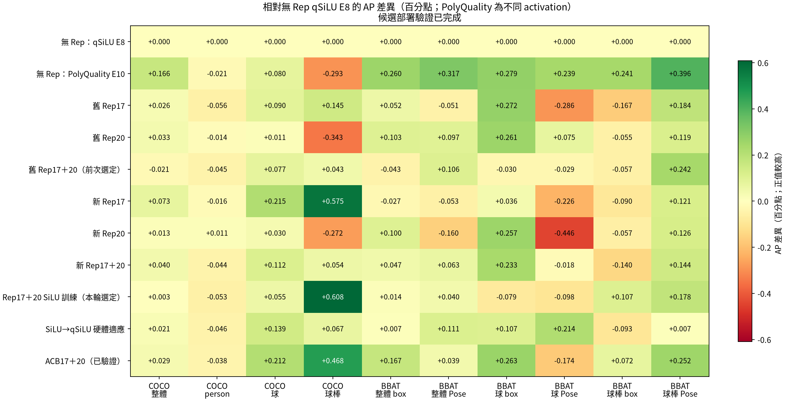
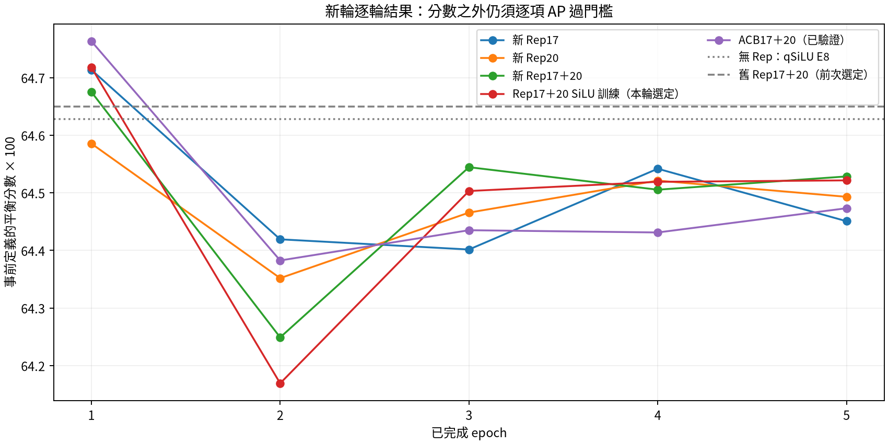
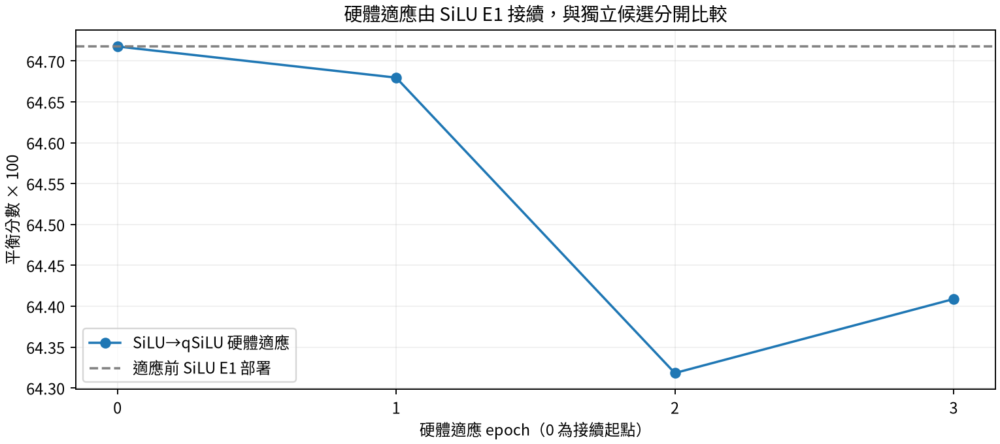

# Stage8 最終比較：無 RepConv、RepConv 與 ACB 的推薦

> **現行選擇（2026-11-17 整理）：** 使用者最後指定的是 **qSiLU 訓練版 Rep17＋20 E1**，正式模型見 [統一交接](../../result/README.md) 與 [selection.json](../../yolo_achitechure/result/stage8-retrain/selection.json)。下文是當時自動選型的歷史比較，原自動推薦 SiLU 訓練候選已非正式模型。未採用的 Rep／ACB 權重和舊包已清理；表中數據仍保留，不代表所有歷史版本現在可直接載入。

**後續使用者決定：採用 qSiLU 訓練版 Rep17＋20 E1（`rep17_20`）。** 預設交接已切換；[選擇紀錄](../../yolo_achitechure/result/stage8-retrain/selection.json) 記錄 SHA、完整指標與原因。下方數據、推薦分析與「選定」用詞保留當時自動選型的口徑，指 `rep17_20_silu`，不代表目前使用者採用的模型。

**目前保留範圍：** qSiLU 訓練版 `rep17_20` 的 folded／多分支最佳權重。其他 Rep／ACB 權重及 optimizer resume 已清理；下列舊交接路徑與 SHA 是當時快照，不表示目前仍可載入。Stage9 已另獲授權接續。

資料截點：2026-11-08T15:04:45.379480+08:00。Stage8 已於 2026-11-08 14:33:07（Asia/Taipei）完成，五組新候選皆完成 folding、重載完整 AP 與獨立 CPU 可攜驗證。當時 handoff 指向 `result/stage8-retrain/handoff/` 並預設 `rep17_20_silu`；後續使用者已改選頁首的 `rep17_20`。GPU compute 工作已結束；Stage9 未開始。

## 直接建議：是否值得加 RepConv

**維持 qSiLU 硬體部署要求時，推薦 Rep17＋20 的 SiLU 訓練候選 E1，部署使用 qSiLU／D1。** 訓練時只有兩個 Rep 相加後的 activation 用 SiLU，其他位置仍是 qSiLU。最終選定的是硬體優化後的 AP，不是 SiLU 原生訓練版 AP。

這是球棒優先的小幅取捨：相對無 Rep 的 qSiLU E8，COCO 球棒提高 0.6085 個百分點、BBAT 球棒 box／Pose 提高 0.1070／0.1782 個百分點；整體 COCO 幾乎持平。person、球 box 與球 Pose 分別降低 0.0532、0.0792、0.0984 個百分點。若較重視這三項，保留無 Rep qSiLU 也合理，沒有必要只為加入 Rep 而更換。

**若放寬 qSiLU activation 要求，以既有模型的整體精度為優先，無 Rep 的 PolyQuality E10 更值得考慮。** 在下表中它比選定 Rep 高 9／10 項，尤其整體 COCO、BBAT box／Pose 較好；唯一較低的是 COCO 球棒，46.610% 對 47.512%，差 0.9018 個百分點。它並非不加 Rep 的等配方控制組，而是 Stage7 另一個 activation 的模型，不能藉此斷言 Rep 本身使精度下降。

三個可用版本的直接比較如下。AP 為 AP50–95（%），最後一欄是所選 Rep 減去無 Rep qSiLU 的百分點。

| 指標 | 無 Rep qSiLU E8 | 選定 Rep17＋20 | 無 Rep PolyQuality E10 | Rep − qSiLU（pp） |
| --- | ---: | ---: | ---: | ---: |
| COCO 整體 | 51.395 | 51.398 | 51.561 | +0.003 |
| COCO person | 64.323 | 64.270 | 64.302 | -0.053 |
| COCO sports ball | 51.466 | 51.521 | 51.547 | +0.055 |
| COCO baseball bat | 46.904 | 47.512 | 46.610 | +0.608 |
| BBAT 整體 box | 61.390 | 61.404 | 61.651 | +0.014 |
| BBAT 整體 Pose | 90.076 | 90.116 | 90.393 | +0.040 |
| BBAT 球 box | 49.743 | 49.664 | 50.022 | -0.079 |
| BBAT 球 Pose | 86.473 | 86.375 | 86.712 | -0.098 |
| BBAT 球棒 box | 73.038 | 73.145 | 73.279 | +0.107 |
| BBAT 球棒 Pose | 93.679 | 93.857 | 94.075 | +0.178 |

原本無 Rep qSiLU 已具備 B2、S1、D1 PWL＋reciprocal，並非加入 Rep 才有算子簡化。Rep／ACB 折疊後回到原位置的單一 3×3 Conv，對原本單 Conv 的卷積 MAC 不會再減少；採用理由是訓練後的精度取捨，沒有實測加速結論。

PolyQuality 同樣保留 B2／S1／D1，也沒有 activation 執行期除法；但現行實作需要 4 次資料相乘來形成二至五次冪，另有一般固定係數乘法。qSiLU 只需 1 次共用平方、dyadic 係數與分段選擇，已有局部整數 reference。PolyQuality 尚無對應整數 emulator；較複雜的是 activation 的定點實作，不是 Attention。這些只是運算 proxy，不能解讀成整網資源或速度差 4 倍。

## 口徑、血緣與狀態

完整 COCO 官方 val5000 與 BBAT5 v1 val683；FP32 E2E、imgsz640、rect validation、conf0.001、iou0.7、max_det300。每列使用單一選定 checkpoint，不逐欄拼接最佳值。除明列 PolyQuality 外，所有部署皆 qSiLU、B2 sign＋Hadamard、S1 Q10／signed16 bias、D1 整數 PWL exp＋LUT256 reciprocal。COCO 球／棒與 BBAT5 球／棒的資料、head 及評估口徑不同。

舊輪三組用 qSiLU／D1 訓練；新輪前三組與 ACB 用 qSiLU／Float PWL，SiLU 組僅兩個 Rep activation 使用 SiLU。五組新候選共同繼承 Stage7 qSiLU E8，選定皆為 E1。PolyQuality 由 Stage6 親代獨立適應 10E，列為既有模型參考，不加入 Stage8 qSiLU 候選排名。硬體適應由 SiLU E1 接續，不是共同 Stage7 parent 的獨立候選。

| 模型 | 完成輪數 | 最佳 epoch | Stage8 AP 保護門檻 | 完成範圍 |
| --- | ---: | ---: | ---: | ---: |
| 無 Rep：qSiLU E8 | 10（Stage7） | 8 | 通過 | 已驗證 |
| 無 Rep：PolyQuality E10 | 10（Stage7） | 10 | 不適用 | Stage7 已完成；不同 activation 的比較模型 |
| 舊 Rep17 | 5 | 1 | 未通過 | 已完成；僅歷史指標 |
| 舊 Rep20 | 5 | 1 | 未通過 | 已完成；僅歷史指標 |
| 舊 Rep17＋20（前次選定） | 5 | 1 | 通過 | 已完成；前次交接保留作比較 |
| 新 Rep17 | 5 | 1 | 未通過 | 5E／folding／重載完整 AP／可攜驗證通過 |
| 新 Rep20 | 5 | 1 | 未通過 | 5E／folding／重載完整 AP／可攜驗證通過 |
| 新 Rep17＋20 | 5 | 1 | 未通過 | 5E／folding／重載完整 AP／可攜驗證通過 |
| Rep17＋20 SiLU 訓練（原自動推薦） | 5 | 1 | 通過 | 5E＋3E 適應完成；選定適應前 E1；全部部署驗證通過 |
| SiLU→qSiLU 硬體適應 | 3 | 1 | 通過 | 3E 完成；未採用；未獨立重載驗證 |
| ACB17＋20（已驗證） | 5 | 1 | 未通過 | 5E／folding／重載完整 AP／可攜驗證通過 |

舊 Rep17／Rep20 的未選權重已依先前授權清理，只保留歷史小型指標。新五組的重載完整 AP 與選定時十項指標完全相同；獨立可攜包在 CPU 160／640 的完整輸出逐值相同。SiLU 硬體適應段有完整逐輪 AP，但未被選定，因此未另做最終獨立重載驗證。

## COCO Detect 四項 AP

| 模型 | 整體 | person | sports ball | baseball bat |
| --- | ---: | ---: | ---: | ---: |
| 無 Rep：qSiLU E8 | 51.395 | 64.323 | 51.466 | 46.904 |
| 無 Rep：PolyQuality E10 | 51.561 | 64.302 | 51.547 | 46.610 |
| 舊 Rep17 | 51.421 | 64.268 | 51.556 | 47.049 |
| 舊 Rep20 | 51.429 | 64.310 | 51.477 | 46.561 |
| 舊 Rep17＋20（前次選定） | 51.374 | 64.279 | 51.544 | 46.947 |
| 新 Rep17 | 51.468 | 64.307 | 51.681 | 47.479 |
| 新 Rep20 | 51.409 | 64.334 | 51.497 | 46.632 |
| 新 Rep17＋20 | 51.435 | 64.280 | 51.578 | 46.958 |
| Rep17＋20 SiLU 訓練（原自動推薦） | 51.398 | 64.270 | 51.521 | 47.512 |
| SiLU→qSiLU 硬體適應 | 51.416 | 64.277 | 51.605 | 46.971 |
| ACB17＋20（已驗證） | 51.424 | 64.285 | 51.679 | 47.372 |

## BBAT5 六項 AP

| 模型 | 整體 box | 整體 Pose | 球 box | 球 Pose | 球棒 box | 球棒 Pose |
| --- | ---: | ---: | ---: | ---: | ---: | ---: |
| 無 Rep：qSiLU E8 | 61.390 | 90.076 | 49.743 | 86.473 | 73.038 | 93.679 |
| 無 Rep：PolyQuality E10 | 61.651 | 90.393 | 50.022 | 86.712 | 73.279 | 94.075 |
| 舊 Rep17 | 61.443 | 90.025 | 50.015 | 86.187 | 72.871 | 93.863 |
| 舊 Rep20 | 61.493 | 90.173 | 50.004 | 86.548 | 72.982 | 93.798 |
| 舊 Rep17＋20（前次選定） | 61.347 | 90.183 | 49.713 | 86.445 | 72.981 | 93.921 |
| 新 Rep17 | 61.364 | 90.024 | 49.779 | 86.247 | 72.948 | 93.801 |
| 新 Rep20 | 61.490 | 89.916 | 50.000 | 86.027 | 72.981 | 93.805 |
| 新 Rep17＋20 | 61.437 | 90.139 | 49.976 | 86.455 | 72.898 | 93.823 |
| Rep17＋20 SiLU 訓練（原自動推薦） | 61.404 | 90.116 | 49.664 | 86.375 | 73.145 | 93.857 |
| SiLU→qSiLU 硬體適應 | 61.398 | 90.187 | 49.850 | 86.687 | 72.945 | 93.686 |
| ACB17＋20（已驗證） | 61.558 | 90.115 | 50.006 | 86.299 | 73.109 | 93.931 |

## 各組優劣

| 方案 | 優點 | 缺點／限制 | 建議 |
| --- | ---: | ---: | ---: |
| 無 Rep qSiLU | 共同 parent；部署契約已成立；person 與球 Pose 略高於選定 Rep | COCO 球棒與 BBAT 球棒較低 | 保守替代方案 |
| 無 Rep PolyQuality | 本表整體 COCO、BBAT box／Pose 與多數細項較高 | COCO 球棒較低；activation 定點實作較複雜，非 qSiLU 契約 | 整體精度優先時的比較選項 |
| 舊 Rep17 | 球 box 50.015% | 球 Pose、球棒 box 退步超過門檻；權重已清理 | 歷史負結果 |
| 舊 Rep20 | 球 Pose 86.548%、整體 box 61.493% | COCO 球棒未過門檻；權重已清理 | 歷史取捨 |
| 舊 Rep17＋20 | 整體 Pose 90.183%、球棒 Pose 93.921%；交接完整 | 綜合分數與 COCO 球棒低於本輪選定 | 保留前次成果作比較 |
| 新 Rep17 | Rep 候選中 COCO 整體 51.468%、球 51.681% 最高 | 球 Pose 相對 parent 降 0.2265 pp | 未通過逐項門檻 |
| 新 Rep20 | 本表 person 64.334% 最高 | 球 Pose 降 0.4460 pp，另整體 Pose、COCO 球棒未過門檻 | 不優先 |
| 新 Rep17＋20（qSiLU 訓練） | COCO、球 box、整體 Pose 高於 parent | 球棒 box 降 0.1401 pp | 未通過逐項門檻 |
| Rep17＋20（SiLU 訓練） | 本表 COCO 球棒 47.512% 最高；部署驗證與門檻通過 | person、球 box、球 Pose 微降；球 Pose 貼近門檻 | qSiLU 部署主線推薦 |
| SiLU→qSiLU 硬體適應 | 相對適應前，球 Pose 改善 0.3125 pp | COCO 球棒降 0.5415 pp；綜合分數較低；未獨立最終重驗 | 未採用的任務取捨 |
| ACB17＋20 | Rep／ACB 候選中整體 box、球棒 Pose 與平均分數較高 | 球 Pose 降 0.1737 pp，未過門檻；訓練卷積量較大 | 不作本輪預設主線 |

## 固定選型規則與限制

Stage8 先要求十項 AP 相對 qSiLU E8 各自降低不超過 0.1 個百分點，再比較 `0.5 ×（COCO 四項平均＋BBAT 六項平均）`。採用須比 parent 增加至少 0.0001 原始分數，並與舊最佳比較、完成部署驗證。這是事前固定的選型工具，不是官方整體 mAP；PolyQuality 的分數只供跨 activation 參考。

| 模型 | 平衡分數 × 100 | 相對 qSiLU 分數差 | 門檻說明 |
| --- | ---: | ---: | ---: |
| 無 Rep：qSiLU E8 | 64.627687 | +0.000000 | 無退化超標 |
| 無 Rep：PolyQuality E10 | 64.763518 | +0.135831 | 不同 activation，不列 Stage8 正式選型 |
| 舊 Rep17 | 64.653579 | +0.025892 | ball_pose_AP50_95: -0.2863 pp；bat_box_AP50_95: -0.1672 pp |
| 舊 Rep20 | 64.638519 | +0.010831 | baseball_bat_AP: -0.3429 pp |
| 舊 Rep17＋20（前次選定） | 64.650296 | +0.022609 | 無退化超標 |
| 新 Rep17 | 64.713683 | +0.085995 | ball_pose_AP50_95: -0.2265 pp |
| 新 Rep20 | 64.585573 | -0.042114 | baseball_bat_AP: -0.2715 pp；pose_AP50_95: -0.1601 pp；ball_pose_AP50_95: -0.4460 pp |
| 新 Rep17＋20 | 64.675271 | +0.047584 | bat_box_AP50_95: -0.1401 pp |
| Rep17＋20 SiLU 訓練（原自動推薦） | 64.717811 | +0.090124 | 無退化超標 |
| SiLU→qSiLU 硬體適應 | 64.679711 | +0.052024 | 無退化超標 |
| ACB17＋20（已驗證） | 64.763296 | +0.135609 | ball_pose_AP50_95: -0.1737 pp |

SiLU E1 球 Pose 為 86.374703%，parent 為 86.473099%，下降 0.098396 pp，距離門檻只剩約 0.001604 pp。ACB 雖然平均分數高，球 Pose 未過門檻，因此不能只用平均分數取代 SiLU。原 optimize 工程規則另外要求 COCO 增加至少 0.1 pp 或 Pose 增加至少 0.2 pp；本輪五組均未通過該原工程規則，不能把目前採用描述為達到所有原目標。

所有差異均來自單 seed 與 validation 選型；沒有新做同預算、未改方法的 control 加訓，也沒有獨立 test 或顯著性分析。不能將小差異當作穩定提升，或把額外適應帶來的全部差異歸因於 Rep 結構。

## 訓練算子轉為部署算子的差距

同 checkpoint 下，qSiLU／ACB 候選只改 Float PWL→D1；SiLU 組同時改 Rep SiLU→qSiLU 及 Float PWL→D1，不能單獨歸因於 activation。硬體適應段本來就以 qSiLU／D1 前向。

| 模型 | 訓練 COCO | 部署 COCO | 訓練球棒 | 部署球棒 | 球棒差 pp | 訓練 Pose | 部署 Pose |
| --- | ---: | ---: | ---: | ---: | ---: | ---: | ---: |
| 新 Rep17 | 51.475 | 51.468 | 47.483 | 47.479 | -0.005 | 90.023 | 90.024 |
| 新 Rep20 | 51.397 | 51.409 | 46.611 | 46.632 | +0.021 | 89.953 | 89.916 |
| 新 Rep17＋20 | 51.437 | 51.435 | 47.059 | 46.958 | -0.101 | 90.144 | 90.139 |
| Rep17＋20 SiLU 訓練（原自動推薦） | 51.396 | 51.398 | 47.871 | 47.512 | -0.359 | 90.141 | 90.116 |
| SiLU→qSiLU 硬體適應 | 51.416 | 51.416 | 46.971 | 46.971 | +0.000 | 90.187 | 90.187 |
| ACB17＋20（已驗證） | 51.427 | 51.424 | 47.437 | 47.372 | -0.065 | 90.116 | 90.115 |

SiLU E1 的 COCO 球棒由訓練版 47.870604% 轉為部署版 47.512050%，降低 0.358554 pp。依 protocol 完成 3E 硬體適應後，其最佳 E1 的球 Pose 增加 0.3125 pp，但 COCO 球棒、BBAT 球棒 box／Pose 分別降低 0.5415／0.1996／0.1711 pp，故仍選適應前 E1。較差的後段沒有覆蓋最佳。

## 訓練與部署成本

| 候選 | 訓練結構參數 | 折疊後參數 | 部署檔 MiB |
| --- | ---: | ---: | ---: |
| rep17 | 26,519,984 | 26,453,680 | 101.781 |
| rep20 | 26,717,104 | 26,453,424 | 101.778 |
| rep17_20 | 26,783,152 | 26,453,168 | 101.774 |
| rep17_20_silu | 26,783,152 | 26,453,168 | 101.774 |
| acb17_20 | 28,423,088 | 26,453,168 | 101.774 |

無 Rep qSiLU 與 PolyQuality 的現有模型均為 26,453,936 個參數；雙 Rep／ACB 折疊後為 26,453,168，僅少 768 個參數（約 3 KiB FP32）。這來自所選位置 BN affine／Conv bias 的表示，不是模型大幅縮小；公平的原模型 Conv-BN fusion 也可得到相應單 Conv 結構。參數數量含固定與可訓參數，不表示全部都更新。

同輸出大小、通道與 groups=1，所選層僅計卷積前向 MAC：原 3×3 是 9 份，Rep 的 3×3＋1×1 是 10 份，ACB 的 3×3＋1×3＋3×1 是 15 份；folding 後均為 9 份。因此 ACB 在這些層的訓練卷積量為 Rep 的 1.5 倍，但不是整網 1.5 倍，也不含 BN、activation、backward。相對無 Rep 原單 3×3，折疊後卷積 MAC 相同。

D1 是完整整數 PWL exp [-10,0]／20 段＋LUT256 reciprocal，沒有最後浮點除法重正規化。模型中 Conv、QKV、P·V、projection、activation 任務路徑與 head sigmoid 等仍有浮點運算。沒有 RTL／HLS、實板 latency 或能耗量測，不能由 folding 或參數數字推論實測加速。

## 逐輪曲線

五個新候選皆完成 5E，最佳部署候選皆為 E1，SiLU 另完成 3E 硬體適應。新輪共 28 個完整 epoch，加舊輪 15 個，共 43 筆；Stage7 的兩個既有 checkpoint 只列最終指標，這個 epoch CSV 不含 Stage7 曲線。相同配方延長沒有足夠改善依據，因此沒有觸發額外 5E。

## optimize 的原 Rep 實驗參考

以下為 optimize 原實驗固定 E5，來源為各 arm 的正式 summary.json。parent 是帶 Pose MASF 的 B E5，與本輪無 MASF 的 Stage7 parent 不同；原 BitTrue 分母也不同於本輪完整 D1。保留原口徑，不能直接據此推論哪種 Rep 實作更好。

| optimize E5 | COCO | person | 整體 box | 整體 Pose | 球 box | 球 Pose | 球棒 box | 球棒 Pose |
| --- | ---: | ---: | ---: | ---: | ---: | ---: | ---: | ---: |
| rep17 | 50.588 | 62.727 | 60.816 | 88.943 | 49.179 | 85.755 | 72.454 | 92.131 |
| rep20 | 50.608 | 62.694 | 60.787 | 88.704 | 49.065 | 85.359 | 72.509 | 92.048 |
| rep17_20 | 50.587 | 62.699 | 60.980 | 89.104 | 49.240 | 85.888 | 72.720 | 92.320 |

原實驗只有 Rep17＋20 通過其工程門檻；該門檻另要求 COCO 增加至少 0.1 pp 或 Pose 增加至少 0.2 pp，不能與本輪的平衡分數採用規則混用。

## 執行與驗證完成情況

SiLU 曾在 11 月 7 日 E1、11 月 8 日 E5 發生三次 SIGSEGV；前兩次 core 指向 libcuda／cuStreamSynchronize，根因未確認。外層於 09:40:53 使用一次有限重試，從完整 E4 恢復，之後 5E、3E 硬體適應及驗證完成。ACB 5E、重載 AP 與可攜驗證完成，未觀察到同類 SIGSEGV。成功完成不等於 CUDA 根因已修復。

本次比較查核再次確認 410 項研究來源 SHA 未變，Stage8 五個部署 checkpoint SHA 均與 manifest／驗證結果相符。既有交接驗證是 CPU FP32 160／640 合成輸出比對，與完整資料集 AP 評估分開記錄；本次沒有重新啟動 GPU 或更改訓練配方。

## 可直接使用的模型與重畫資料

- [本輪 Rep／ACB 可攜交接](../../yolo_achitechure/result/stage8-retrain/handoff/README.md)：目前預設 `rep17_20`（使用者選定 qSiLU 訓練版），完整 qSiLU／D1 部署；使用包內 `load_model`，保留 manifest 與 runtime。
- [無 Rep qSiLU／PolyQuality 可攜交接](../../yolo_activation/result/stage7/handoff/README.md)：兩種 activation 需按各自 manifest 重建。
- [11 列完整 AP CSV](data/stage8-20261108/metrics.csv)、[43 個完整 epoch](data/stage8-20261108/epochs.csv)、[訓練／部署差距](data/stage8-20261108/operator-gaps.csv)、[結構成本](data/stage8-20261108/costs.csv)。
- [快照與來源 SHA](data/stage8-20261108/snapshot.json)、[離線重畫程式](data/stage8-20261108/redraw.py)、[本次工作紀錄](../worklogs/2026-11-08-stage8-results-comparison.md)。

只需 Python、NumPy 與 Matplotlib：`python docs/research/data/stage8-20261108/redraw.py`。不需 GPU、checkpoint 或研究套件。Stage8 在此停止；後續特徵圖研究的 `yolo_actshape` 仍待指定。
