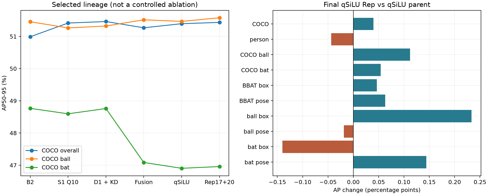
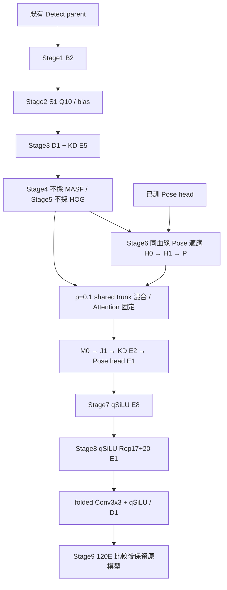
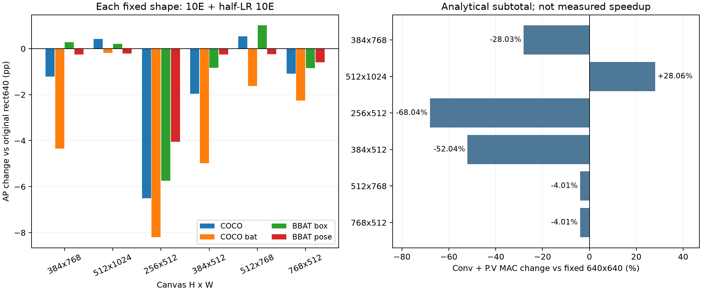

# YOLO 整合研究總結與最終交接

> 11 月 19 日依用途指定兩份模型。固定 512×768 的適應 E2 用於硬體，原 rect640 的 Rep17＋20 E1 用於精度。本文記錄 11 月 17 日的階段結論。[現行模型交接](../../result/README.md)

本輪第 1～9 階段已結束；最後的 768×512 於 **2026-11-13 00:07（Asia/Taipei）** 完成，2026-11-17 完成全輪整理。統一使用入口為根層 [result/](../../result/README.md)。本次只整理與驗證既有成果，沒有新增 GPU 實驗、修改訓練配方或改寫來源鎖。

正式成果是使用者指定的 **qSiLU 訓練版 Rep17＋20 E1（`rep17_20`）**，部署使用 qSiLU／D1／B2／S1，沿用原 **batch rect640 letterbox**。Stage9 沒有固定尺寸通過全部採用門檻，因此保留此模型。它不是 Stage8 原自動推薦的 SiLU 訓練版，也不代表十項指標各自最高。

## 最終模型與精度

權重 SHA256：`2454548104ed64768eb9ecdb99d44804ee9d8e1e371e2a508cf052c0911fdd35`。folded 模型 **26,453,168 個參數**，checkpoint **106,717,343 bytes（101.77 MiB）**；檔案大小不等於純參數容量。

下表均為 AP50–95 百分比；COCO 使用官方 val5000，BBAT5 v1 使用原 val683。COCO 球／棒與 BBAT 的球／棒分屬不同資料和 head，不能互換。最後一欄是最終模型減去 Stage7 qSiLU parent 的百分點，同一列的所有指標來自同一 checkpoint。

| 指標 | 無 Rep qSiLU E8 | 最終 qSiLU Rep17＋20 E1 | 差異（百分點） |
|---|---:|---:|---:|
| COCO 整體 | 51.3951% | 51.4347% | +0.0396 |
| COCO person | 64.3234% | 64.2796% | -0.0438 |
| COCO sports ball | 51.4662% | 51.5782% | +0.1120 |
| COCO baseball bat | 46.9036% | 46.9576% | +0.0541 |
| BBAT 整體 box | 61.3904% | 61.4371% | +0.0466 |
| BBAT 整體 Pose | 90.0762% | 90.1389% | +0.0628 |
| BBAT ball box | 49.7430% | 49.9764% | +0.2334 |
| BBAT ball Pose | 86.4731% | 86.4546% | -0.0185 |
| BBAT bat box | 73.0378% | 72.8977% | -0.1401 |
| BBAT bat Pose | 93.6792% | 93.8233% | +0.1440 |

Stage7 到 Stage8 的提升幅度小，person、BBAT ball Pose 與 bat box 略降；不能宣稱全面提升。最初獨立 Detect parent 的 COCO AP 為 52.4686%，本輪最終融合模型為 51.4347%，仍低約 1.0338 個百分點；兩者圖結構與任務不同，差距不能全歸因於單一算子。Stage6 原獨立模型目標未全部達成、Stage8 原自動門檻與使用者選擇有差異，這些負結果都保留。

實際來源：[Stage8 使用者選擇](../../yolo_achitechure/result/stage8-retrain/selection.json)、[正式 manifest](../../result/manifest.json)、[完整 Rep 比較](stage8-comparison-2026-11-08.md)。歷史比較報告中的「選定／推薦」可能指當時的自動 SiLU 候選，現行正式選擇以本報告和 `result/manifest.json` 為準。

## 每階段做了什麼、為何採用

| 階段 | 完成工作與結果 | 主線決策及正式來源 |
|---|---|---|
| 1 Binary branches | B1／B2／B3 各 10E，B2 的 COCO AP 50.9889% 最佳；再恢復 5E 未超過初篩最佳 | 採 sign＋Hadamard 的 B2，兩處各四 heads、16 個 scale slots。[結果](../../yolo_binaryqk/artifacts/stage1/formal-20261018-v2/RESULTS.md) |
| 2 scale／bias | S1 Q10 與 S2 二次冪各 5E，同一 B2 parent；AP 51.4152%／51.3711% | 採 S1，保留 signed16／1024 軸向分解 bias；二次冪未取得精度優勢。[結果](../../yolo_binaryqk/artifacts/stage2/formal-20261019-v1/RESULTS.md) |
| 3 normalization／Softmax | N1～N6 完整 AP，Top-1／3／5 診斷排除；D1／D2／D3 完整數值與任務比較 | 採 D1 整數 PWL exp＋LUT256 reciprocal；零加訓 AP 51.4189%，KD 5E 後 51.4621%。未達原 +0.001 自動增益門檻，使用者覆核採用 E5。[交接](../../yolo_attention/result/stage3/README.md) |
| 4 MASF | Detect／Pose task-specific P3，含 L1／L2 延長；檢查 alpha、bridge 梯度與多尺度資料流 | 兩任務均未採用；保留原 Detect／已訓 Pose。候選、正式數據與必要 resume 依使用者要求保留，尚未在最終融合模型重試。[結果](../../yolo_masf/artifacts/stage4/extension-20261019-v1/RESULTS.md) |
| 5 HOG | coverage／梯度檢查、訓練候選、移除 head 等價；一輪後觸發球／棒精度門檻 | 不採 HOG；選定權重仍是 Stage3 KD E5。HOG 實體訓練產物已清理。[結果](../../yolo_hog/result/stage5/README.md) |
| 6 Detect–Pose 融合 | 參照 optimize 完整分段流程，先做同血緣 Pose 適應，再 ρ=0.1 混合、聯合恢復、KD 與 Pose head 恢復 | 選 KD E2 → Pose head E1；COCO 51.2676%、box 60.9202%、Pose 89.9850%。原四項精度目標未全部達成，使用者接受後續研究。[結果](../../yolo_combine/result/stage6/README.md) |
| 7 Activation | qSiLU／Hardswish／PolyShift／PolyQuality 各 10E；公式、導數、敏感度與重載 AP | PolyQuality 為綜合比較最佳；按要求將 qSiLU E8 固定為 Rep parent。COCO 51.3951%。[結果](../../yolo_activation/result/stage7/README.md) |
| 8 Rep／ACB | 舊三組與新五組均完成；新輪各 5E，SiLU 另 3E 適應。分別驗證 folding 與部署算子切換 | 使用者指定新輪 qSiLU Rep17＋20 E1。只保留此正式 folded 包與多分支 EMA；其他權重已清理，小型比較數據保留。[交接](../../yolo_achitechure/result/stage8-retrain/README.md) |
| 9 形狀與硬體分析 | 原流程＋9 個固定尺寸 E0；6 組各 10E＋半 LR 10E，共 120E；分塊／排列共 336 項 GPU replay 通過 | 維持原模型與 rect640。所有完整 AP、負結果與候選可用性分開記錄。[前 100E](../../yolo_actshape/result/stage9/README.md)、[768×512 的 20E](../../yolo_actshape/result/stage9-portrait/README.md) |

以上是依序繼承的研究，各階段任務、可訓範圍與訓練預算不同，不是從同一 parent 出發的九組消融。沒有為未改方法另加 control 訓練。

## 真實模型血緣與融合方式

融合先把原 Pose head 接到 Detect 血緣的圖，經 H0／H1 head 適應，再做 P 段 Pose 全模型適應；不是直接把兩個獨立 backbone 平均。混合為 `D_shared + 0.1 × (P_shared − D_shared)`，排除全部 Attention；Detect head 取 D，Pose head 取 P。後續各段使用獨立 LR 排程與 fresh EMA，較差後段不覆蓋最佳。原 Pose 訓練不重跑，BBAT5 split／來源／標註不變。

Stage6 獨立兩模型共 45,428,208 參數，融合後 26,453,936，減少約 41.77%；這是模型參數比較，**不是整網運算量或實測延遲下降 41.77%**。詳細模型圖、配方、父 checkpoint 與 SHA 見 [融合 manifest](../../yolo_combine/result/stage6/manifest.json)。主線節點的實體權重與完整 SHA 另見 [lineage.json](data/integrated-20261117/lineage.json)。

## 部署簡化做到了哪些

| 部分 | 正式部署契約 | 尚存成本或限制 |
|---|---|---|
| QK | B2 原 sign＋Hadamard，共兩處各四 heads | 二值點積可映射為位元運算；現有 PyTorch 任務模型不等於已部署 bit-packed 硬體。Hadamard、QKV 形成與投影仍需計入 |
| scale／bias | 16 個 S1 Q10 固定常數；`by[dy]+bx[dx]` 的 signed16／1024 表 | Q10 一般係數仍需乘法或移位加法組合；不因係數固定就視為零成本 |
| Softmax | row-max → 整數 PWL exp `[-10,0]`／20 → 權重累加 → 每列 LUT256 reciprocal → probability | UQ1.16 reciprocal、uint26 分母、UQ1.24 probability；max_tokens1024／max_axis32。沒有末端浮點除法強制 row-sum=1 |
| qSiLU | `ShiftPiecewiseQuadraticSiLU`／`qsilu_pq` 固定分段及 dyadic 係數 | 一次共用平方、移位加法與區間選擇；目前任務前向仍是浮點張量，不等於整網定點 |
| Rep17＋20 | 訓練 Conv3×3＋BN 與 Conv1×1＋BN 相加後 qSiLU；部署折疊為單 Conv3×3 後 qSiLU | qSiLU 不折入 Conv。相對原來單 Conv 的推論圖，Rep 不額外減少該層卷積 MAC；收益是訓練後精度取捨 |
| 其餘運算 | 已稽核剩餘 Conv／QKV／P·V／projection／BN／head／decode 與非線性 | 尚有浮點、Sigmoid／Tanh、正規化與除法等，依各路徑列明；未完成整網量化或所有算子硬體化 |

完整細項見 [operator-gaps.csv](data/stage8-20261108/operator-gaps.csv)；本輪沒有以修改剩餘算子為由另啟新研究。原 Stage1 分析在 640×640 未 fuse 前向中，整網浮點 MAC 小計僅減少約 **0.109%**；新增二值操作與形成成本另列，不能把 QK 二值化稱作整網大幅加速。[Binary 成本](../../yolo_binaryqk/artifacts/stage1/formal-20261018-v2/COST.md)

Rep 的線性 folding 等價與完整輸出等價、非零新增分支、FP32／實際 dtype、重載後 qSiLU 類別／係數／位置均有原階段證據。訓練 normalization 為 Float PWL，最終部署為 D1；部署 AP 使用後者。不同算子切換的精度影響與同算子 folding 的數值誤差分開判斷。

## 為什麼是 40×40、長方形與二次冪的結果

40×40 是既有 stride2 金字塔在輸入 640×640 時的其中一級：五級空間尺寸為 320、160、80、40、20。這不是只能使用正方形的限制，也不是每個像素值反覆除以 2；是 stride2 卷積的取樣步進。

| Canvas H×W | P1 → P2 → P3 → P4 → P5 |
|---|---|
| 640×640 | 320×320 → 160×160 → 80×80 → 40×40 → 20×20 |
| 512×512 | 256×256 → 128×128 → 64×64 → 32×32 → 16×16 |
| 512×768 | 256×384 → 128×192 → 64×96 → 32×48 → 16×24 |
| 768×512 | 384×256 → 192×128 → 96×64 → 48×32 → 24×16 |
| 512×1024 | 256×512 → 128×256 → 64×128 → 32×64 → 16×32 |

本輪驗證的是在既有 stride 架構下，改 canvas 帶動內部特徵圖；**固定輸入不變、獨立修改某一級 stride／尺度的架構變體尚未實作**。原正式 rect640 依 batch 長寬比產生矩形，不等於上表的固定 640×640。

每個適應候選皆從同一 Stage8 parent 獨立開始，固定 10E＋半 LR 10E，沿用原訓練與 evaluator。Task weight 使用同一 train-only 校準政策，可能因候選梯度不同而得到不同數值，不能描述為每個數值都完全相同。768×512 沒有增加第三段或新配方。

| H×W／流程 | COCO AP | person AP | COCO 球棒 AP | BBAT box AP | Pose AP | MAC 相對固定 640×640 |
|---|---:|---:|---:|---:|---:|---:|
| 原 rect640 | 51.4347% | 64.2796% | 46.9576% | 61.4371% | 90.1389% | 不直接比較 |
| 384×768 | 50.2160% | 62.4010% | 42.6170% | 61.7208% | 89.8808% | -28.03% |
| 512×1024 | 51.8553% | 64.6954% | 46.7692% | 61.6512% | 89.9204% | +28.06% |
| 256×512 | 44.9273% | 56.2016% | 38.7581% | 55.6881% | 86.0849% | -68.04% |
| 384×512 | 49.4749% | 61.6394% | 41.9711% | 60.6093% | 89.8889% | -52.04% |
| 512×768 | 51.9632% | 64.5865% | 45.3351% | 62.4501% | 89.9026% | -4.01% |
| 768×512 | 50.3517% | 62.9266% | 44.6974% | 60.5912% | 89.5456% | -4.01% |

表中 MAC 是雙任務 Conv＋P·V 的解析小計，參考為固定 640×640 的 47.407616 GMAC，**不是相對正式動態 rect640 的節省**。512×768 綜合較有競爭力，但 COCO 球棒低 1.6225 個百分點、Pose 低 0.2364 個百分點，未通過全部門檻。768×512 的十項 AP 均低於 512×768；其平均補邊更多、有效影像縮放較小，是可能因素，尚無獨立因果實驗。

二次冪可簡化部分位址控制，但不保證算量較少。例如 512×1024 的 MAC 增加 28.06%；40×40 用 8×8 tile 沒有空格，用 16×16 tile 則需 48×48 配置，格子容量增加 44%。空間容量分析不含所有 halo、雙緩衝或峰值存活張量。

已做七組共 294 項，以及直向候選 42 項 GPU replay，合計 **336 項通過**。包含排列／分塊／卷積 halo＋qSiLU／完整 keys 的 D1 query 分塊；這些是算子等價性診斷，尚未把分塊替換進正式任務執行引擎，QK 分數矩陣仍完整物化。

FP32、batch1、雙任務 PyTorch 同步量測中，固定 640×640 中位數 29.6725 ms、512×768 為 29.6809 ms、768×512 為 29.4187 ms；此次資料不支持穩定 GPU 加速結論。沒有 RTL／HLS 綜合、指定 FPGA／ASIC 資源約束或板端量測。[完整硬體形狀分析](../../yolo_actshape/analysis/HARDWARE_SHAPES.md)

## 資料夾責任與清理

| 入口／資料夾 | 整理後角色 |
|---|---|
| 根層 `result/` | 統一交接入口、最終 manifest、清理與檢查紀錄；以相對連結引用實體成果 |
| `yolo_binaryqk`、`yolo_attention` | Stage1～3 正式結果及共用算子；Attention 仍只有一處主實作 |
| `yolo_masf` | 已完成的 MASF 比較、使用者指定保留的候選與必要 resume |
| `yolo_hog` | 負結果、程式、小型數據與原主線連結 |
| `yolo_combine`、`yolo_activation`、`yolo_achitechure` | 融合／activation／Rep 各階段 result、必要 source 與唯一模型 |
| `yolo_actshape` | 形狀研究、兩份結果報告、正式包及仍可用的尺寸候選 |
| `docs/research`、`docs/worklogs` | 研究總結、計畫、可重畫數據、工作紀錄與索引 |
| `yolo_optimize`、`original`、已訓 Pose 來源 | 唯讀／保護來源；此次未改動 |

Stage9 原 100E 已清理約 3.57 GiB，直向補充已清理約 0.63 GiB。本次另清除第 1、2 階段的 **6 份 optimizer resume 和 92 個可重建快取，1,296,444,995 bytes（1.2074 GiB）**；這是本次獨立數字，不重複計算歷史清理。選定模型、B1／B2／B3／S2 最佳比較權重、小型原始數據與來源鎖保持。

Stage1／2 的舊 `handoff.json` 是不可改寫的歷史證據，裡面曾列出的 resume 路徑已不代表目前可用；新 [Stage1 availability](../../yolo_binaryqk/result/stage1/availability.json) 與 [Stage2 availability](../../yolo_binaryqk/result/stage2/availability.json) 記錄現況。這兩階段可從最佳權重開新段，但不能精確接回已刪 optimizer 狀態。

下列內容經查仍有必要，未因名稱看似舊資料夾而刪除：

- `yolo_combine/final/full35`、`variants/full35`：optimize 的 runtime／bridge 仍直接讀取程式、設定與 Pose 權重。
- `yolo_achitechure/achitechure_1`、`yolo_p2`、精簡過的 `yolo_attention_final`：optimize 與本輪來源仍依賴其程式／設定／相容入口。
- 舊 activation 必要權重與 release：仍有外部量化研究依賴；`yolo_quantize` 未指定重建。
- Stage3 KD resume：HOG 的 source guard 仍核對它的 SHA；MASF 必要 resume 則依使用者先前要求保留。
- 來源不明或無法證明無用的舊檔、虛擬環境與使用者簡報保持原狀；不把整個工作區強行清空。

逐檔 SHA、大小、保留原因與實際刪除結果在 [cleanup-20261117.json](../../result/cleanup-20261117.json)。未建立 archive／backup，沒有重複複製正式大模型；本次不 commit／push。

## 驗證與未解事項

本次檢查來源鎖、主線 checkpoint／EMA、相對連結與文件入口；從新 `result/model` 入口重跑 CPU 可攜驗證，核對完整輸出及錯誤 SiLU 的拒絕。沒有重跑先前已完成的 GPU AP；引用各階段原始 AP／folding／GPU replay 證據，與此次檔案驗證分開記錄。具體通過項目見 [validation.json](../../result/validation.json) 與 [中文工作紀錄](../worklogs/2026-11-17-integrated-research-handoff.md)。

所有比較主要為單 seed、validation 選型，缺少未改方法的同預算 control；小差距不宜宣稱統計顯著。融合原精度目標、固定尺寸取捨、全網整數量化與真正硬體成本仍有未解問題。先前一次 CUDA 原生崩潰根因未確認，後續完成訓練不等於驅動根因已修復。Stage9 完成後沒有啟動其他研究。

[重畫資料與程式](data/integrated-20261117/README.md) 只需 CSV、NumPy、matplotlib，不需要 GPU、checkpoint 或資料集。各階段更細的二值／scale／Softmax／MASF／融合／activation／Rep 圖表仍由上方正式結果入口維護，避免另建一整套重複成果。
