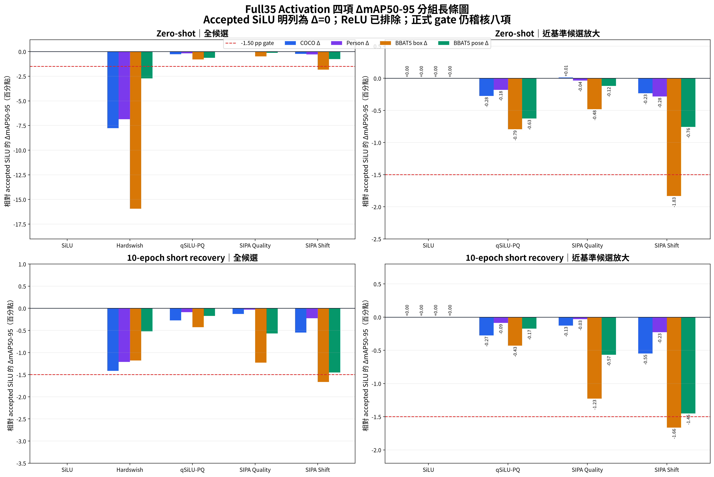
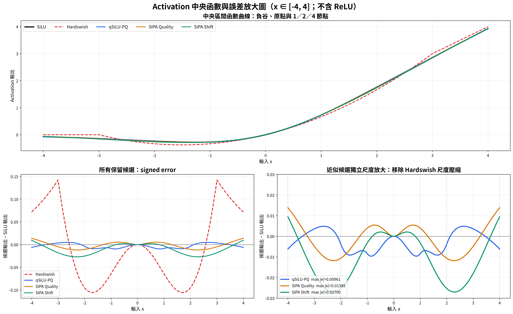
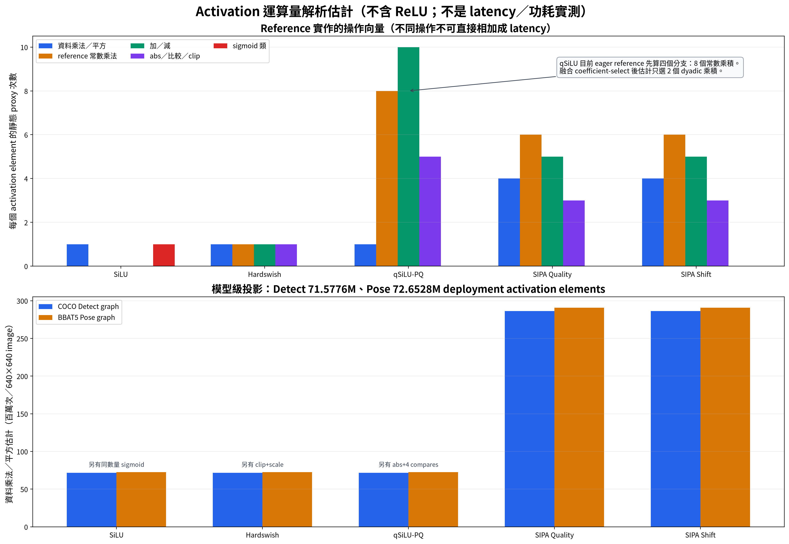

# 已完成 Activation 整合報告

日期：2026-08-30
適用模型：YOLO26m Full35 shared trunk + COCO80 Detect head + BBAT5 Pose26 head

## 1. 這份報告回答什麼

這份報告只整理「本專案實際完成、實作或評估過的 activation」，不把計畫中的工作寫成已完成成果。
程式 registry 仍保留六種 activation；本報告的最終比較、圖表與運算量估計只納入下列五種：

1. `silu`：正式父模型與精度控制組。
2. `hardswish`：既有硬體鄰近 baseline。
3. `qsilu_pq`：本專案凍結的 C¹、dyadic 分段二次 SiLU 近似。
4. `poly_quality`：SIPA 的品質導向 C² 積分多項式。
5. `poly_shift`：SIPA 的 dyadic／APoT C² 積分多項式。

ReLU 的 zero-shot 八項指標都是 0，已足以完成診斷，因此依要求不再放入後續精度表、函數圖與
運算量比較；原始結果仍保留在 machine-readable JSON，沒有刪除實驗證據。

BCSP 不是第七種 activation；它是逐區域 activation placement 的 bounded search 支援架構。本輪完成
BCSP 的 manifest、region、queue 與 gate propagation，但沒有得到實際 mixed-policy 搜尋結果。

## 2. 最終狀態總表

| Activation | 實作 | Full zero-shot | 10-epoch recovery | Finalist | 可交付權重 | 目前定位 |
| --- | --- | --- | --- | --- | --- | --- |
| SiLU | PyTorch／原模型 | accepted baseline | sham control 已跑 | seed-1 control 完成，epoch 6 early-stop | 有 | 正式基準與量化 control |
| Hardswish | PyTorch standard op | 完成、失敗 | 完成、失敗 | 排除 | 未發布 | 硬體 baseline／負結果 |
| `qsilu_pq` | PyTorch／Q16.10／ONNX | 完成、通過 | 完成、通過 | 人工停止，只有 provisional epoch 1 | 有 10-epoch 權重 | 唯一保留的非 SiLU 量化候選 |
| `poly_quality` | PyTorch float reference | 完成、通過 | 完成、失敗 | 排除 | 未發布 | SIPA 品質 profile／負結果 |
| `poly_shift` | PyTorch／Q16.10／ONNX | 完成、失敗 | 完成、失敗 | 排除 | 未發布 | SIPA shift profile／硬體數學對照 |

因此最重要的結論是：

> 已完成的 non-SiLU 候選中，只有 `qsilu_pq` 通過完整 COCO2017 + Canonical BBAT5 v1 的
> 10-epoch 八項 accuracy gate；下一階段應比較 accepted SiLU 與 qSiLU 的量化行為。

## 3. 共用數學骨架

本專案的主要候選都可寫成

\[
A(x)=\frac{x}{2}+H(|x|).
\]

因為 \(H(|x|)\) 是偶函數，所以

\[
A(x)-A(-x)=x.
\]

這項 symmetry invariant 精確成立，不是訓練後的近似統計。若 \(H(0)=0\)，則 \(A(0)=0\)；若
\(u=|x|\ge T\) 時 \(H(u)=u/2\)，則正尾端精確為 \(x\)，負尾端精確為 0。

### 3.1 SiLU

\[
\operatorname{SiLU}(x)=x\sigma(x)
=\frac{x}{2}+\frac{|x|}{2}\tanh(|x|/2).
\]

- 光滑、含負輸出谷與非單調導數。
- 原模型實際使用的 activation，也是所有 delta 的 accuracy reference。
- 硬體可依賴 backend fused SiLU；若自行實作，仍需要 sigmoid／exp 類非線性。

### 3.2 Hardswish

\[
\operatorname{Hardswish}(x)=
\begin{cases}
0,&x\le-3,\\
x(x+3)/6,&-3<x<3,\\
x,&x\ge3.
\end{cases}
\]

- 中央區間是二次式，兩端是 exact ReLU tails。
- 只有 C⁰；在 \(-3\) 與 \(3\) 的一階導數不連續。
- 常見 backend 有 fused operator，但本模型直接 zero-shot 會產生很大的 feature drift。

### 3.3 qSiLU：`qsilu_pq`

令 \(u=|x|\)，定義

\[
Q(x)=\frac{x}{2}+h(u),
\]

\[
h(u)=
\begin{cases}
\frac{57}{256}u^2,&0\le u<1,\\
\frac{23}{256}u^2+\frac{17}{64}u-\frac{17}{128},&1\le u<2,\\
-\frac{11}{512}u^2+\frac{91}{128}u-\frac{37}{64},&2\le u<4,\\
-\frac{5}{1024}u^2+\frac{37}{64}u-\frac{5}{16},&4\le u<8,\\
\frac12u,&u\ge8.
\end{cases}
\]

等價的截斷平方表示為

\[
h(u)=\frac{57}{256}u^2-\frac{17}{128}[u-1]_+^2
-\frac{57}{512}[u-2]_+^2+\frac{17}{1024}[u-4]_+^2
+\frac{5}{1024}[u-8]_+^2.
\]

- knots 為 1、2、4、8，全部是二的冪。
- 全部係數是 dyadic；融合 datapath 可共用一次 \(u^2\)。
- 全域 C¹、保留負谷與非單調導數，\(|x|\ge8\) 為 exact ReLU。
- \([-8,8]\) 對 SiLU：MAE 0.0051297、RMSE 0.0060978、max error 0.0108319。
- 已通過 float、Q16.10 bit-true 與 ONNX gate。
- 「硬體友善」目前是結構判斷；尚未有指定 FPGA／ASIC 的 latency、power 或 resource 實測。

### 3.4 SIPA 一般式

令 \(z=u/T\in[0,1]\)，先設計偶殘差導數

\[
q_a(z)=az+(9-\frac92a)z^2+(6a-16)z^3
+(\frac{15}{2}-\frac52a)z^4.
\]

四項約束為

\[
q_a(0)=0,\quad q_a(1)=\frac12,\quad q_a'(1)=0,\quad
\int_0^1q_a(t)\,dt=\frac12.
\]

積分後

\[
R_a(z)=\frac a2z^2+(3-\frac32a)z^3
+(\frac32a-4)z^4+(\frac32-\frac12a)z^5,
\]

\[
H_{T,a}(u)=T R_a\left(\frac{\min(u,T)}{T}\right)+\frac{[u-T]_+}{2}.
\]

這組約束同時保證 zero anchor、symmetry invariant、C² 接合與 exact ReLU tails。完整線性解與連續性
證明在[六種 activation 完整数學推導](../docs/research/full35-activation-mathematical-derivations.md)。

#### `poly_quality`

\[
a=4,\qquad T=\frac{109}{16},
\]

\[
H(u)=\frac{32}{109}u^2-\frac{768}{11881}u^3
+\frac{8192}{1295029}u^4-\frac{32768}{141158161}u^5.
\]

- 負谷約 \(-0.27904\)，接近原始 SiLU。
- 係數不是 dyadic，需要一般常數乘法器或再近似。
- zero-shot 是所有 proposed profiles 中最貼近 baseline 的一個，但 10-epoch recovery 的 BBAT ball
  box 超出 gate，不能只看函數 MSE 或 COCO 指標選它。

#### `poly_shift`

\[
a=\frac92,\qquad T=8,
\]

\[
H(u)=\frac9{32}u^2-\frac{15}{256}u^3
+\frac{11}{2048}u^4-\frac3{16384}u^5,\qquad 0\le u\le8.
\]

- 直接係數全部是 dyadic／APoT，可用 shift-add 表示常數。
- 仍需形成 \(u^2,u^3,u^4,u^5\)，所以不是零乘法器設計。
- 完成 11-region zero-shot sensitivity，但 uniform 10-epoch gate 失敗，後續 BCSP jobs 依規則封鎖。

### 3.5 Fixed-point invariant

若整數輸入 code 為 \(n\)，正負輸入共用同一個 \(\widehat H(|n|)\)，則

\[
\widehat A(n)=\left\lfloor\frac n2\right\rfloor+\widehat H(|n|)
\]

可保持

\[
\widehat A(n)-\widehat A(-n)=n.
\]

尾端採 \(\widehat H(u)=\lceil u/2\rceil\) 時，奇數 code 的正／負 ReLU tails 也能保持 0 LSB
誤差。這是量化工作列應繼續驗證的 bit-exact 性質，不等於 PTQ／QAT AP 已經完成。

## 4. 模型、資料與比較契約

| 項目 | 固定值 |
| --- | --- |
| 父模型 | YOLO26m Full35 shared trunk + COCO80 Detect + BBAT5 Pose26 |
| 父權重 | `yolo_combine/final/full35/weights/combined/inference/best_joint.pt` |
| 父權重 SHA-256 | `d67fb45c576035e1b9c607914c62fa2c46bad84a5f53dea2c95ea7d4155ec74c` |
| COCO2017 | 118,287 train／5,000 val |
| Canonical BBAT5 v1 | 5,964 formal train／683 formal val |
| 影像尺寸 | 640 |
| 資料比例 | `fraction=1.0`、`resampling=false` |
| Activation sites | 190 references、11 regions |
| Selector backend | Bit-True |
| Accuracy gate | 八項 mAP50-95 每一項 delta 都必須 ≥ -0.015 |

沒有建立 30% 資料夾、重新切分或修改 BBAT5 樣本／標註。COCO 與 BBAT5 raw AP 不互相平均；每項
指標都直接對 accepted SiLU baseline 計算 delta。

## 5. 訓練設定

| 階段 | Epoch | Seed | Patience／warm-up | LR scale | 狀態 |
| --- | ---: | ---: | --- | ---: | --- |
| Baseline／zero-shot／profiling | 0 | 0／1 | — | — | 完成 |
| Uniform short recovery | 10 | 1 | 0／1 | 原 J3 的 0.1× | 四候選完成 |
| Region sensitivity／BCSP search | 10 | 1 | 0／1 | 原 J3 的 0.1× | 14 jobs gate-blocked |
| Finalist seed 1 | 最多 20 | 1 | 5／3 | 原 J3 的 1.0× | SiLU 完成；qSiLU 人工停止 |
| PTQ | 0 | 1 | calibration | — | 尚未在本專案執行 |
| QAT if needed | 10 | 1 | 0／1 | 原 J3 的 0.5× | 未啟動 |

Recovery 共用 AdamW、weight decay \(2.7\times10^{-4}\)、betas (0.948, 0.999)、AMP、gradient clip
10 與 cosine final factor 0.5。Short recovery LR：backbone 3.8e-7、neck 1.9e-6、MASF 3.8e-6、
attention 5e-8、Detect／Pose heads 5e-6。

Detect logical batch 固定 128。qSiLU physical batch 128、64、32 都在第一個 forward OOM；physical
16 可穩定完成，因此以梯度累積維持 logical batch。這是目前 eager PyTorch reference 在 31.35 GiB
GPU 的實測，不是 fused kernel 的理論上限。

## 6. Accepted baseline

| 指標 | mAP50-95 |
| --- | ---: |
| COCO box | 0.498022 |
| COCO person box | 0.620381 |
| BBAT box | 0.630036 |
| BBAT pose | 0.903717 |
| BBAT ball box | 0.507437 |
| BBAT bat box | 0.752634 |
| BBAT ball pose | 0.859909 |
| BBAT bat pose | 0.947526 |

## 7. Uniform zero-shot

每個候選儲存格均寫成「實際 mAP50-95（相對 accepted SiLU 的 Δ）」；Gate 要求八項 Δ 全部不低於
`-0.015`，不平均不同資料集或類別。

| 指標 | Accepted SiLU | Hardswish | `qsilu_pq` | `poly_quality` | `poly_shift` |
| --- | ---: | ---: | ---: | ---: | ---: |
| COCO box | 0.498022 | 0.420324 (-0.077698) | 0.495272 (-0.002750) | 0.498145 (+0.000123) | 0.495705 (-0.002317) |
| COCO person box | 0.620381 | 0.551738 (-0.068644) | 0.618594 (-0.001787) | 0.620030 (-0.000352) | 0.617536 (-0.002845) |
| BBAT5 box | 0.630036 | 0.470703 (-0.159332) | 0.622102 (-0.007933) | 0.625238 (-0.004798) | 0.611708 (-0.018327) |
| BBAT5 pose | 0.903717 | 0.876465 (-0.027252) | 0.897445 (-0.006272) | 0.902543 (-0.001174) | 0.896160 (-0.007557) |
| 最差 Δ／Gate | — | -0.176230／失敗 | -0.013091／通過 | -0.005501／通過 | -0.022064／失敗 |

zero-shot 顯示 `poly_quality` 的函數貼合度很好，但它不能預測 recovery 後的 class-level 穩定性。
Hardswish 不是「直接套上就保持原精度」；activation 更換會同時改變 190 個 sites 的 feature
distribution，因此需要 matched recovery。

## 8. 10-epoch short recovery

| 指標 | Accepted SiLU | Hardswish | `qsilu_pq` | `poly_quality` | `poly_shift` |
| --- | ---: | ---: | ---: | ---: | ---: |
| COCO box | 0.498022 | 0.483861 (-0.014161) | 0.495273 (-0.002749) | 0.496755 (-0.001268) | 0.492545 (-0.005477) |
| COCO person box | 0.620381 | 0.608270 (-0.012111) | 0.619505 (-0.000876) | 0.620074 (-0.000307) | 0.618118 (-0.002263) |
| BBAT5 box | 0.630036 | 0.618224 (-0.011811) | 0.625751 (-0.004285) | 0.617772 (-0.012263) | 0.613396 (-0.016640) |
| BBAT5 pose | 0.903717 | 0.898519 (-0.005198) | 0.901986 (-0.001731) | 0.898036 (-0.005681) | 0.889203 (-0.014514) |
| 最差 Δ／Gate | — | -0.016884／失敗 | -0.008635／通過 | -0.020970／失敗 | -0.030138／失敗 |

主表與主圖依要求只顯示 COCO、Person、BBAT5 box、BBAT5 pose 四項摘要；「最差 Δ／Gate」仍由正式
八項 selector 計算。因此 Hardswish recovery 即使四根摘要長條都在 `-0.015` 內，仍因 BBAT5 bat
pose `-0.016884` 正式失敗。這避免圖表精簡後誤寫 gate 結論。

上圖是四項分組長條圖，accepted SiLU 明列為 `Δ=0`，紅色虛線為 `-1.50` 百分點。左欄顯示
Hardswish 在內的全部候選，右欄放大接近基準的 qSiLU 與兩個 SIPA profile。可縮放的向量版見
[`activation-accuracy-overview.svg`](figures/activation-accuracy-overview.svg)，逐列 raw／delta 資料見
[`activation-accuracy-summary.csv`](figures/activation-accuracy-summary.csv)。

## 9. 函數近似精度與中央誤差放大圖

以下是 float64、`[-8,8]` 等距 400,001 點的純函數比較；SiLU 是零誤差 reference。這些數字衡量
activation 公式，不是 detector mAP，也沒有用 validation 指標回頭調係數。

| Activation | MAE vs SiLU | RMSE vs SiLU | 最大絕對誤差 |
| --- | ---: | ---: | ---: |
| SiLU | 0 | 0 | 0 |
| Hardswish | 0.0462761 | 0.0606127 | 0.1422776 |
| `qsilu_pq` | **0.0051297** | **0.0060978** | **0.0108319** |
| `poly_quality` | 0.0094349 | 0.0113170 | 0.0210018 |
| `poly_shift` | 0.0139339 | 0.0165891 | 0.0269959 |

上圖把中央區間固定為 `x ∈ [-4,4]`。上半部保留完整函數形狀；左下保留 Hardswish 以顯示尺度；
右下只放 qSiLU 與兩個 SIPA profile，並把 y 軸固定為 `[-0.03,0.03]`。因此不再因 Hardswish 的
`0.1423` 大誤差而看不出三個近似函數的差異。可縮放向量版見
[`activation-central-error-enlarged.svg`](figures/activation-central-error-enlarged.svg)，完整數值見
[`activation-function-metrics.csv`](figures/activation-function-metrics.csv)。

## 10. 運算量解析估計

下表是每個 activation element 的靜態操作 proxy。它把資料乘法、常數乘積、加減、範圍控制與
transcendental 分開，**不可直接相加成 FLOPs、latency 或功耗**。`reference` 欄對應目前 PyTorch
實作；qSiLU 的 `fused` 欄是先選區段係數再計算的預期資料路徑。

| Activation | 資料乘法／平方 | Reference 常數乘積 | 加／減 | abs／比較／clip | Sigmoid 類 | 融合後解讀 |
| --- | ---: | ---: | ---: | ---: | ---: | --- |
| SiLU | 1 | 0 | 0 | 0 | 1 | Backend 可融合成標準 SiLU；自行展開仍有 sigmoid 與資料乘法 |
| Hardswish | 1 | 1 個一般常數 | 1 | 1 | 0 | Backend 可融合；展開為 add／clip／multiply／scale |
| `qsilu_pq` | **1 個共享平方** | 8 個 dyadic（eager 四分支） | 10 | 5 | 0 | 先做 coefficient-select 後只選 2 個 dyadic 乘積，加減上限估計 8 |
| `poly_quality` | 4 | 6 個一般常數 | 5 | 3 | 0 | 四個資料冪乘法，常數需要一般乘法或再次近似 |
| `poly_shift` | 4 | 6 個 dyadic | 5 | 3 | 0 | 四個資料冪乘法；常數乘積可降成 shift-add |

完整 train profiling 換算出的 640×640 deployment graph，每張 COCO Detect 影像有 71,577,600 個
activation elements，每張 BBAT5 Pose 影像有 72,652,800 個。只投影「資料乘法／平方」後得到：

| Activation | Detect 百萬次／image | Pose 百萬次／image | 未計入的主要成本 |
| --- | ---: | ---: | --- |
| SiLU | 71.5776 | 72.6528 | 同數量 sigmoid，或 backend fused op |
| Hardswish | 71.5776 | 72.6528 | clip 與 `1/6` scale，或 backend fused op |
| `qsilu_pq` | **71.5776** | **72.6528** | abs、4 個 threshold compares、每元素最多 2 個已選 dyadic 乘積 |
| `poly_quality` | 286.3104 | 290.6112 | 6 個一般常數乘積／element |
| `poly_shift` | 286.3104 | 290.6112 | 6 個 dyadic shift-add 乘積／element |

可縮放向量版見 [`activation-operation-estimate.svg`](figures/activation-operation-estimate.svg)，所有欄位與
模型級投影見 [`activation-operation-estimate.csv`](figures/activation-operation-estimate.csv)。目前沒有
指定 FPGA／ASIC 的 synthesis、clock、precision、latency、power、LUT、DSP 或 BRAM 實測，因此只能
稱為解析估計，不能宣稱 qSiLU 已在真實硬體快於 fused SiLU／Hardswish。

## 11. Finalist 與 BCSP 的誠實邊界

### Finalist

- SiLU seed-1 control：20-epoch 上限、patience 5；第 6 個已完成 epoch early-stop，選定結果 worst
  delta -0.012872，正式通過。
- qSiLU seed-1：完成 epoch 1 後進入 epoch 2 macro 106，再依使用者要求停止。epoch 1 provisional
  worst delta -0.015966，只有 BBAT ball box 超過門檻 0.000966。
- qSiLU finalist 沒有 completion marker，也沒有正式 `best_joint.pt`；不能宣稱 finalist 已失敗或勝出。

### SIPA–BCSP

- SIPA：數學、兩個 profile 的 PyTorch reference、`poly_shift` 的 Q16.10／ONNX、zero-shot、
  11-region sensitivity 與 10-epoch recovery 都有實際成果。
- BCSP：190-site manifest、11 regions、policy schema、bounded queue、dependency 與 gate propagation
  已完成。
- BCSP 實際搜尋：沒有完成。`poly_shift` prerequisite 失敗後，8 個 region recovery 與 6 個 mixed
  policies 共 14 jobs 正確標記 blocked。
- 因此目前不能宣稱 BCSP 找到最佳 placement，也不能宣稱 normalized-regret search、random／greedy
  或 ActNAS-style comparison 已完成。

## 12. 硬體證據邊界與量化決策

| Activation | 結構成本判斷 | Accuracy 證據 | 決策 |
| --- | --- | --- | --- |
| SiLU | sigmoid／exp 或標準 fused op | accepted baseline | 保留量化 control |
| Hardswish | 標準 fused op 或 add/clip/multiply | recovery 未過 | 保留負結果，不進 finalist |
| qSiLU | 一個共享平方、dyadic 係數、4 個區段 | 唯一 non-SiLU recovery 通過 | 進入 matched PTQ |
| `poly_quality` | 四個資料冪乘法、一般常數 | recovery 未過 | 暫停 |
| `poly_shift` | 四個資料冪乘法、dyadic 常數 | recovery 未過 | 暫停 BCSP |

目前沒有 target FPGA／ASIC 的 synthesis、clock、precision、latency、power、LUT、DSP 或 BRAM 實測；
表中的成本是結構 proxy，不是板上量測。

量化建議固定為：

1. 使用相同 calibration images、observer、per-channel／per-tensor 與 rounding 規則，先比較 accepted
   SiLU 與完成的 qSiLU 10-epoch 權重。
2. 記錄每個 activation region 的 range、scale、zero-point、clip ratio、saturation 與 knots
   1／2／4／8 附近誤差。
3. 枚舉 Q8／Q12／Q16 全輸入碼，驗證 symmetry invariant、exact tails、overflow 與 saturation。
4. 只有 PTQ 任一八項超過 -0.015 預算時，才用 matched 10-epoch budget 同時比較 QAT SiLU 與 qSiLU。
5. 完成量化後再決定是否恢復 qSiLU 20-epoch finalist；現階段不繼續 activation-only 調參。

## 13. 可直接使用的交付

| 交付 | 路徑／SHA-256 |
| --- | --- |
| 完整八項結果 JSON | [`full35-activation-results.json`](full35-activation-results.json) |
| 八項寬表 CSV | [`full35-activation-results.csv`](full35-activation-results.csv) |
| 精度、中央誤差與運算量圖 | [`figures/README.md`](figures/README.md) |
| 不含 ReLU 的精度 raw／delta CSV | [`activation-accuracy-summary.csv`](figures/activation-accuracy-summary.csv) |
| 函數誤差與運算量 CSV | [`activation-function-metrics.csv`](figures/activation-function-metrics.csv)／[`activation-operation-estimate.csv`](figures/activation-operation-estimate.csv) |
| 所有公式詳細推導 | [`full35-activation-mathematical-derivations.md`](../docs/research/full35-activation-mathematical-derivations.md) |
| Accepted SiLU 權重 | `d67fb45c576035e1b9c607914c62fa2c46bad84a5f53dea2c95ea7d4155ec74c` |
| qSiLU 10-epoch 權重 | `7679186695317e431cd7deb17289f426f4b39b7a4993e4548e74f5ba2766190e` |
| 權重分片與重建 | [`release/weights/README.md`](../release/weights/README.md) |

兩個權重皆已用 GitHub 分片發布並完成逐片與重建後 SHA-256 驗證。未發布 qSiLU interrupted
`last.pt`、425 MB resume checkpoints、OOM probe payload 或未過 gate 的候選權重。

## 14. 最終結論

目前真正完成並值得帶往下一階段的是：

- **SiLU**：正式 baseline、matched control 與量化對照。
- **qSiLU**：唯一通過 10-epoch 八項 gate 的 non-SiLU 候選，也是唯一應進入 matched PTQ 的新函數。
- **SIPA profiles**：數學與負結果都已完成，保留作論文消融及硬體設計參照，但目前不進一步訓練。
- **Hardswish**：保留作標準硬體鄰近 baseline 與負結果，不是最終候選。
- **BCSP**：完成支援架構，尚未完成搜尋實驗，不能列為已驗證演算法成果。

在量化結果出來前，不需要再做 activation-only 最佳化。下一個決策點是：qSiLU 的 dyadic 分段結構
能否在相同 PTQ／QAT 規則下，保留 Full35 八項精度並降低實際部署成本。
