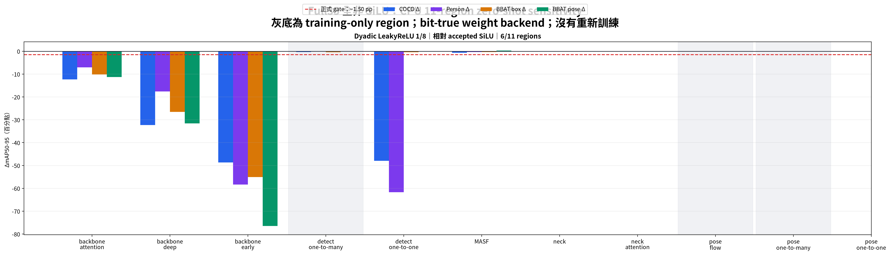

# Full35 全非 SiLU CPU Q3：11-region Zero-shot Sensitivity

> 狀態：6/6 candidate-region cases。這是 zero-shot validation，沒有 optimizer、backward、epoch 訓練或權重更新。

## 實驗契約

- 最終 policy 的 190 個 activation sites 均不得為 SiLU。
- 基底權重：已完成的 qSiLU 10-epoch short-recovery `best_joint.pt`。
- 裝置：CPU；backend：bit-true weights；資料比例 100%，不抽樣、不重新切分。
- 資料：COCO2017 與 Canonical BBAT5 v1。
- 主表四項 Δ 相對同裝置 uniform recovered qSiLU；正式 gate 仍相對同裝置 accepted SiLU 稽核八項。

## CPU Baseline

| Metric | accepted SiLU | uniform recovered qSiLU | qSiLU Δ |
| --- | ---: | ---: | ---: |
| COCO | 0.498460 | 0.495313 | -0.003147 |
| Person | 0.620334 | 0.619684 | -0.000650 |
| BBAT box | 0.629451 | 0.625257 | -0.004193 |
| BBAT pose | 0.902102 | 0.901469 | -0.000633 |

## 圖表

灰底 region 是 training-only graph；其替換結果不代表部署推論節省。

## Region 結果

### Dyadic LeakyReLU 1/8

| Region | 類型 | COCO Δ | Person Δ | BBAT box Δ | BBAT pose Δ | 八項最差 global Δ | Gate |
| --- | --- | ---: | ---: | ---: | ---: | ---: | --- |
| `backbone_attention` | deployment | -0.120063 | -0.069499 | -0.097142 | -0.111852 | -0.158882 | 未通過 |
| `backbone_deep` | deployment | -0.319445 | -0.175528 | -0.261598 | -0.315181 | -0.362355 | 未通過 |
| `backbone_early` | deployment | -0.483353 | -0.582812 | -0.546675 | -0.763966 | -0.883096 | 未通過 |
| `detect_one2many` | training-only | +0.000000 | +0.000000 | +0.000000 | +0.000000 | -0.008810 | 通過 |
| `detect_one2one` | deployment | -0.476243 | -0.616454 | +0.000000 | +0.000000 | -0.617104 | 未通過 |
| `masf` | deployment | -0.003327 | -0.002378 | +0.000721 | +0.003232 | -0.007597 | 通過 |
| `neck` | 待執行 | — | — | — | — | — | — |
| `neck_attention` | 待執行 | — | — | — | — | — | — |
| `pose_flow` | 待執行 | — | — | — | — | — | — |
| `pose_one2many` | 待執行 | — | — | — | — | — | — |
| `pose_one2one` | 待執行 | — | — | — | — | — | — |

## 證據邊界

- 這是逐 region 一次只替換一區的一階 zero-shot sensitivity，不能取代多區 mixed policy 完整驗證。
- CPU 與 GPU 不保證 bitwise 相同；本報告所有 delta 都使用同一 CPU backend baseline，避免跨裝置相減。
- `leaky_relu_1_8` 在本階段以 float graph 的精確 1/8 係數執行；真正 INT8／RTL bit-exact 屬於後續量化階段。
- 運算量欄位是解析 proxy，不是 latency、功耗或面積實測。

機器可讀結果：[`summary.json`](summary.json)／[`rows.csv`](rows.csv)。
