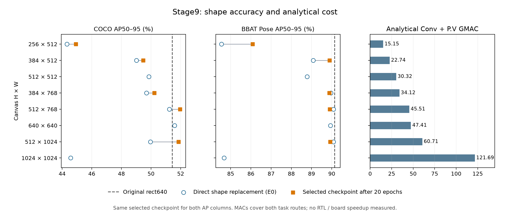

# Stage9 完整形狀研究結果

> **2026-11-17 整理補充：** 本頁為原 100E 的完整結果。其後 768×512 已完成另外 20E，Stage9 合計 120E；[直向比較](../stage9-portrait/README.md) 與 [統一交接](../../../result/README.md) 已完成，原正式模型保持。

**2026-11-11 06:25:37（Asia/Taipei）完成全部 100 輪與交付。** 五組尺寸各跑 10E＋半 LR 10E；GPU 已釋放，沒有啟動下一階段。

採用 **reference_rect640**，即使用者選定的 **qSiLU 訓練版 Rep17＋20 E1 與原 batch rect640 letterbox 流程**，並非強制固定 640×640。沒有固定尺寸通過所有採用門檻，正式交接保持此模型。

包含初輪及新增三組尺寸。Stage8 qSiLU Rep17＋20 最終 parent 保持。尺寸順序均為 H×W。

五組適應完成後的最佳模型如下。所有數值為 AP50–95 百分比，同一列來自同一份 checkpoint，不拼接各項最高值。MAC 差異以**固定 640×640** 的雙任務 Conv＋P.V 47.407616 GMAC 為參考，不能當成相對原動態 rect640 的實測節省。

| 模型／尺寸 | 最佳 checkpoint | COCO AP | person AP | COCO 球棒 AP | BBAT box AP | Pose AP | 分析 MAC 差異 |
|---|---|---:|---:|---:|---:|---:|---:|
| 原 qSiLU Rep17＋20／rect640 | Stage8 E1 | 51.4347 | 64.2796 | 46.9576 | 61.4371 | 90.1389 | 不同形狀流程，不直接比較 |
| 384×768 | adapt E4 | 50.2160 | 62.4010 | 42.6170 | 61.7208 | 89.8808 | −28.03% |
| 512×1024 | adapt E4 | 51.8553 | 64.6954 | 46.7692 | 61.6512 | 89.9204 | ＋28.06% |
| 256×512 | low-LR E5 | 44.9273 | 56.2016 | 38.7581 | 55.6881 | 86.0849 | −68.04% |
| 384×512 | low-LR E1 | 49.4749 | 61.6394 | 41.9711 | 60.6093 | 89.8889 | −52.04% |
| 512×768 | adapt E2 | 51.9632 | 64.5865 | 45.3351 | 62.4501 | 89.9026 | −4.01% |

512×768 的 COCO AP 比原主線提高 **0.5285 個百分點**、BBAT box 提高 1.0130 個百分點，但 COCO 球棒下降 **1.6225 個百分點**、Pose 下降 0.2364 個百分點，因此未採用。後續降 LR 10E 沒有超過 adapt E2 的綜合選型。512×1024 雖有二次冪長寬，計算量反而增加約 28%；256×512 容量較小，但精度損失明顯。沒有一個尺寸同時保證所有任務的精度與更低成本。

以下保留全部 E0 與適應結果，數值為 0～1。球／棒欄是 COCO 分類別 AP，與 BBAT 的 ball／bat 指標分開。

| 候選／階段 | COCO AP | person AP | 球 AP | 棒 AP | BBAT box AP | Pose AP | Conv＋PV GMAC |
|---|---:|---:|---:|---:|---:|---:|---:|
| reference_rect640/e0 | 0.514347 | 0.642796 | 0.515782 | 0.469576 | 0.614371 | 0.901389 |  |
| fixed640/e0 | 0.515882 | 0.642821 | 0.517833 | 0.472308 | 0.608328 | 0.899351 | 47.407616 |
| square512/e0 | 0.498495 | 0.616532 | 0.493656 | 0.443033 | 0.590633 | 0.887790 | 30.321999872 |
| rect384_768/e0 | 0.496890 | 0.619689 | 0.486474 | 0.422937 | 0.613683 | 0.899531 | 34.116968448 |
| rect512_1024/e0 | 0.499511 | 0.641844 | 0.514608 | 0.462707 | 0.615494 | 0.900870 | 60.711108608 |
| square1024/e0 | 0.445639 | 0.595150 | 0.555747 | 0.485648 | 0.577684 | 0.846701 | 121.690652672 |
| rect384_768/adapted_best | 0.502160 | 0.624010 | 0.489107 | 0.426170 | 0.617208 | 0.898808 | 34.116968448 |
| rect512_1024/adapted_best | 0.518553 | 0.646954 | 0.520212 | 0.467692 | 0.616512 | 0.899204 | 60.711108608 |
| rect256_512/e0 | 0.443173 | 0.554145 | 0.419001 | 0.388182 | 0.537680 | 0.845370 | 15.152611328 |
| rect384_512/e0 | 0.490087 | 0.606963 | 0.471319 | 0.417307 | 0.595389 | 0.890818 | 22.735208448 |
| rect512_768/e0 | 0.512383 | 0.641792 | 0.521741 | 0.443583 | 0.624643 | 0.900845 | 45.508165632 |
| rect256_512/adapted_best | 0.449273 | 0.562016 | 0.424298 | 0.387581 | 0.556881 | 0.860849 | 15.152611328 |
| rect384_512/adapted_best | 0.494749 | 0.616394 | 0.477061 | 0.419711 | 0.606093 | 0.898889 | 22.735208448 |
| rect512_768/adapted_best | 0.519632 | 0.645865 | 0.521912 | 0.453351 | 0.624501 | 0.899026 | 45.508165632 |

十項 AP、各尺寸最佳、來源、負結果與選型均見 [result.json](result.json)／[metrics.csv](metrics.csv)。各尺寸最佳可作硬體成本取捨，不將所有 AP 壓成單一分數而隱去退化。

分塊診斷見 [layout-results.json](extension/layout-results.json)；七組各 42 項、共 **294 項通過**。分塊只作算子 replay，不替換正式任務模型。每個 query 分塊保留全部 keys；QK 分數矩陣仍完整物化。

FP32、batch 1、雙任務同步 PyTorch 推論時間見 [gpu-benchmark.csv](extension/gpu-benchmark.csv)，使用共同原 parent、20 次 warmup 與 100 次量測。固定 640×640 中位數 **29.6725 ms**，512×768 為 **29.6809 ms**；本次未量到 512×768 的 GPU 加速，分析 MAC 減少不能代替時間量測。模型參數不因 canvas 改變而減少。

完整 AP 使用 COCO 5000／BBAT5 v1 683 張；每任務一張的 layout 診斷不代替 AP。tile 記憶體含補齊但不代表峰值 SRAM；Conv+PV MAC 不包含全部算子，也不等於 GPU 或板端加速。

qSiLU／D1 PWL＋LUT256／B2／S1／folded17+20 保留。未改固定輸入下的內部 stride 架構、未做整網整數量化、RTL/HLS 或板端量測。單 seed、validation 選型，沒有原尺寸 control 加訓。

[可直接使用的交接](handoff/README.md) 保留主線 folded 權重、載入程式、shape／算子契約與 manifest。checkpoint SHA256 為 `2454548104ed64768eb9ecdb99d44804ee9d8e1e371e2a508cf052c0911fdd35`，檔案 106,717,343 bytes。五組最佳模型完整重載的十項 AP 最大誤差均為 **0**；交接包的 372 個檔案大小與 SHA 相符，獨立 CPU 可攜驗證 bitwise equal，錯誤 SiLU 替換會被拒絕。證據見 [final-audit.json](final-audit.json)。

初輪與擴充共刪除 **14 份** optimizer resume／未採用權重、**3,832,988,886 bytes（3.57 GiB）**，清單見 [初輪](cleanup.json) 與 [擴充](extension/cleanup.json)。沒有另建 archive／backup。初輪 384×768、512×1024 的適應權重已移除，保留數據與驗證證據；三個新增尺寸的最佳權重仍在原 run，可由 `result.json` 的 available_options 找到。不能把已清理的初輪權重描述為可直接載入。

執行途中處理了電腦重啟、一次 CUDA 原生崩潰及 256×512 的低 LR 校準中斷。最後一項先唯讀參照 optimize 的 16 批量測／8 批確認，再新增有界校準政策；沿用原目標與接受範圍，不增加訓練輪數。原始來源鎖與失敗證據保留，補充來源見 [校準恢復索引](extension/calibration-recovery.json) 與 [工作紀錄](../../../docs/worklogs/2026-11-10-actshape-calibration-recovery.md)。CUDA 原生崩潰根因仍未確認，後續完成訓練不等於已修復驅動根因。

[redraw.py](redraw.py) 只讀 CSV；執行 `python redraw.py` 可在無 GPU／checkpoint 下重畫 [PNG](accuracy-cost.png) 與 [SVG](accuracy-cost.svg)。交付時調整圖表標籤避免重疊，沒有改動實驗數據或來源鎖。完整清理與交付紀錄見 [中文工作紀錄](../../../docs/worklogs/2026-11-11-actshape-stage9-results.md)。

本階段全部完成並停止，未啟動下一階段。
