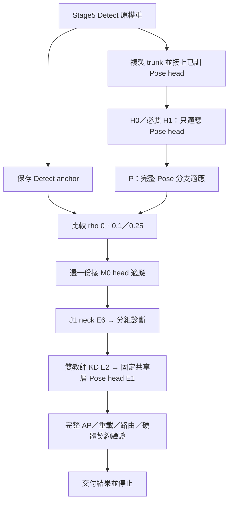

# Detect–Pose 融合：第 6 階段研究交付

2026-10-31：已直接清理 17 份中間權重／optimizer 與 2 份 runtime cache，釋放 2.7115 GiB；保留唯一選定 E1 和小型證據。[清理清單](result/stage6/cleanup-20261031.json)、[Stage7 準備](../yolo_activation/stage7/README.md)。

目前：本輪訓練與驗證已完成，選 **KD E2 → Pose head E1**，唯一入口在 [result/stage6](result/stage6/README.md)。官方 COCO／BBAT 框／關鍵點為 0.512676／0.609202／0.899850；optimize 相同設定重驗完成，CPU 路由與搬移後載入通過。原獨立模型的四項精度目標仍未達，不自動升格；GPU 已釋放；第七階段已完成 CPU 準備，正式 GPU 實驗尚未開始。[完成紀錄](../docs/worklogs/2026-10-30-stage6-results.md)。

2026-10-29 依使用者要求刪除全部舊 Stage6 權重、結果、報告與 queue，釋放約 5.562 GiB，沒有封存。新研究由 Stage5 Detect 與受保護的已訓 Pose 重新出發；程式在 `stage6/`，新輸出在 `artifacts/stage6/rebuild-20261029/`。

**實際執行：H0 8 輪、H1 40 輪、P 43 輪、三個混合比例、M0 11 輪、J1 6 輪、回退診斷、KD 5 輪與 Pose head 恢復 5 輪。** 最後一段最佳 E1 後四輪未改善停止；J2／J3 原條件 queue 未直接展開。完整結果、剩餘缺口與成本見上方正式交付，下方保留配方及操作說明。

先讓 Pose 能讀懂 Detect 的特徵，再融合。「完整 Pose 適應」是在 Detect 副本上調整，不會改寫原 Detect anchor 或原獨立 Pose。



`ρ` 是部署前權重初始化比例：`D + ρ × (P − D)`。只混合已在同一 Detect 起點適應出的共享權重；Detect head 取 anchor，Pose head 取適應分支，Attention 保持不變。部署只有一份共享 trunk，兩個 head 分別輸出 COCO80 偵測與球／球棒的兩個關鍵點。

實作前已核對 optimize `experiments/combine/bridge_v1/` 的程式、實際 resolved config、來源與結果，保存 [來源 SHA 與完整 protocol](artifacts/stage6/reference-review.json)。來源包括 `pose_first.py`、`full_pose_gentle.py`、`merge_pose.py`、`balanced_joint.py`、`j2_stage.py`、`j3_stage.py` 及梯度校準程式。

| 段落 | 可訓練範圍 | 參考 LR | 上限／patience |
|---|---|---|---|
| H0 | Pose head | 2e-4 | 8／無 |
| H1 | Pose head | 2e-4 | 40／10 |
| P | 完整 Pose 分支，Attention 固定 | backbone 1.5e-6、neck 7.5e-6、head 2e-5 | 60／12 |
| M0 | 混合後 Pose head | 2e-4 | 20／10 |
| J1 | neck、兩個 head | neck 7.5e-6、heads 2e-5 | 20，條件總上限 60／8 |
| J2 | layer 9 起的 backbone、neck、兩個 head | backbone 1.5e-6、neck 7.5e-6、heads 2e-5 | 40，條件總上限 80／17 |
| J3 | 全部非 Attention trunk、兩個 head | backbone 3.8e-7、neck 1.9e-6、heads 5e-6 | 20／5 |

每段重新建立 AdamW、EMA age 0 及原生 loss 排程；warmup 1 輪後 cosine 降至 0.5。共同 BN statistics 與 affine 固定，可訓練 head 的 BN 更新。J2 停滯 8 輪可再減半一次。條件延長必須在預算用完時仍有近期改善，使用原始段落 LR 的 0.5／0.25 倍，不承接上一段末端 LR 上限。

聯合訓練每步 Detect 32 × 8 張加 Pose 16 張，reference batch 為 64。每次新聯合階段先以 train-only 16 個 macro 校準 Pose 權重，再以 8 個確認；最多再確認一次。每個 macro 恢復所有權重與 BN，不用 validation 挑 loss 權重。

COCO train 118,287／val 5,000；BBAT5 v1 train 5,964／val 683。資料、標註與分割不更改。獨立來源完整 AP 先重現，之後每輪使用同樣的 FP32 E2E evaluator。

最終 COCO overall／person／sports ball／baseball bat 四項 AP 各下降不超過 0.005，BBAT box／pose 及 ball／bat 分項共六項各下降不超過 0.02。任何一項未通過不能升格主線。訓練安全線另見 protocol；完整 Pose 副本的 COCO 只作診斷，不能當成原 Detect anchor 退化。

B2 二值 QK、S1 Q10／分解式 bias、D1 PWL exp＋整數 reciprocal 均保留；缺少 manifest 明確失敗。J3 也固定 Attention，這點不同於 optimize 的部分 Attention 小 LR。當前 activation 沿用上游 SiLU；qSiLU 在第 7 階段建立，第 8 階段所有 RepConv 都必須使用 qSiLU。MASF／HOG 此輪未採用。沒有 RTL／HLS 或板端量測時不宣稱加速。

```bash
# 查詢已完成的最後一段；不重新啟動訓練。
bash yolo_combine/run_stage6.sh status --output yolo_combine/artifacts/stage6/pose-head-recovery-20261029
# 只讀小型 CSV 重畫成果，不需要 GPU 或 checkpoint。
MPLCONFIGDIR=/tmp/yolo-stage6-matplotlib PYTHONDONTWRITEBYTECODE=1 \
.venv/bin/python yolo_combine/result/stage6/redraw.py
```

訓練期間背景 supervisor 每 600 秒記錄 GPU 與進度，完成或異常立即處理；所有本輪工作現已停止。`result/stage6/` 已提供唯一選定入口、AP、manifest、lineage、CSV 與重畫程式。2026-10-31 已清理全部中間權重與已停止 resume，只留選定 E1；後續用 fresh optimizer 接續。第 7 階段不會自行啟動。

optimize 依賴的 `src/yolo_combine`、`final/full35` 與必要 `variants/full35` 保留；不是新訓練入口。清理、驗證與問題見 [中文工作紀錄](../docs/worklogs/2026-10-29-stage6-clean-rebuild.md)。

2026-10-29 停止規則修正：[工作紀錄](../docs/worklogs/2026-10-29-stage6-head-safety-fix.md)。head-only 使用固定 COCO 與 plateau；BBAT 下降 0.03 的安全線僅適用完整 Pose 分支 P，最終驗收門檻不變。

使用者最新目標：找出實際表現最好的融合模型；optimize 作為參考，階段內由代理依診斷自主調整。[最新研究決策](../docs/worklogs/2026-10-29-stage6-best-fusion-objective.md)。

[16:04 進度與同 checkpoint 的完整比較](../docs/worklogs/2026-10-29-stage6-pose-progress.md)。

[17:23 聯合訓練進度與共享精度落差](../docs/worklogs/2026-10-29-stage6-joint-progress.md)。

[21:44 KD 進度與 optimize 最終 Rep17＋20 的同類 AP 比較](../docs/worklogs/2026-10-29-stage6-optimize-comparison.md)。
