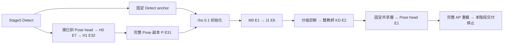

# 第 6 階段：Detect–Pose 融合研究結果

2026-10-30 完成本輪交付，2026-10-31 完成中間權重清理。選定 **KD E2 → Pose head 恢復 E1** 作為目前測得的最佳綜合候選。最後一段於 2026-10-29 **23:47** 完成：共跑 5 輪，最佳為 E1，後續 4 輪未改善而停止；完整重載 AP 通過。GPU 工作已結束，第 7 階段已做 CPU 準備，正式 GPU 實驗尚未啟動。

與 optimize 最終模型使用相同設定重驗後，目前 COCO 與 BBAT 框精度接近，整體及球棒關鍵點較高。**原獨立模型的全部精度目標仍未通過**，所以此處是可覆核的研究候選交付，不是自動通過主線驗收，也不宣稱已找到全域最優解。

## 權重、設定與載入

- [selected.pt](selected.pt) 與 [selected.json](selected.json)：唯一選定入口，連到本資料夾內實體權重，沒有複製第二份模型。
- SHA256：`e9b9fd7ccc88f10bbd170835138ebde5c7810db0726424496e2cac2aa462ffe7`。
- [handoff.json](handoff.json)：精度、選型狀態、原目標缺口、檢查結果與下一階段邊界。
- [manifest.json](manifest.json)：完整資料、模型血緣、activation、B2／S1／D1 常數及部署契約。
- [完整 AP 重載驗證](pose-head-recovery/verification/result.json)、[最後一段 protocol](pose-head-recovery/protocol.json) 與 [history.csv](history.csv)。

在 `/home/uxin/yolo` 執行；只載入 CPU，不訓練：

```bash
PYTHONDONTWRITEBYTECODE=1 \
PYTHONPATH=yolo_combine:yolo_combine/src:yolo_attention/src:yolo_binaryqk:yolo_masf:yolo_activation/src:yolo_achitechure/achitechure_1/src \
.venv/bin/python - <<'PY'
from stage6.checkpoint import load
model = load('yolo_combine/result/stage6/selected.pt')
print(type(model).__name__)
PY
```

載入會核對 SHA、內外 manifest、strict state dict 與硬體契約；不接受缺少設定後默默切回浮點 Softmax。`model(images, task="both")` 共用一次 trunk；`detect`／`pose` 可單獨路由。

2026-10-31 清理：E5 resume 與其他已停止的中間權重已移除，目前只留選定 E1 實體權重。下一階段從 E1 建立新 optimizer，不使用已刪的 E5。選定權重含重建所需 manifest／state dict，仍需要本工作區的共用算子程式。完整路徑與 SHA 見 [清理清單](cleanup-20261031.json)。

## 與 optimize 最終模型同設定比較

參考為 optimize **Rep17＋20 E5、Pose-only MASF、qSiLU、BitTrue PWL**，SHA `9d9306f3574eb584c5adbe43c303afb2865109234ddf6dcb4c866b63901fc161`，由其 [CURRENT.json](../../../yolo_optimize/reports/current-model/CURRENT.json) 確認。不是早期 qSiLU E2 或另一個同名 Rep run。

本次以 optimize 自包含 loader 在隔離程序載入原 runtime，使用當前 evaluator 重跑完整 COCO val 5,000 與 BBAT5 v1 val 683。兩者都是 batch 8、FP32、E2E、rect stride 32、conf 0.001、IoU 0.7、max_det 300；核對資料順序及 batch padding 一致。耗時 68.21 秒，沒有加訓。參考 [事前核對與來源 SHA](../../artifacts/stage6/final-review-20261029/protocol.json)、[重驗結果](../../artifacts/stage6/final-review-20261029/optimize-result.json)、[CSV](comparison.csv)。

| AP50–95 | optimize 同設定重驗 | 本輪選定 | 差值（百分點） |
|---|---:|---:|---:|
| COCO 整體，內部 evaluator | 0.506187 | 0.505687 | −0.050 |
| COCO person，內部 evaluator | 0.626935 | 0.624764 | −0.217 |
| BBAT 框 | 0.609756 | 0.609202 | −0.055 |
| BBAT 關鍵點 | 0.890691 | 0.899850 | +0.916 |
| 球框 | 0.492020 | 0.493883 | +0.186 |
| 球關鍵點 | 0.858289 | 0.863474 | +0.519 |
| 球棒框 | 0.727493 | 0.724521 | −0.297 |
| 球棒關鍵點 | 0.923092 | 0.936227 | +1.313 |
| COCO 整體，官方 evaluator | 0.512066 | 0.512676 | +0.061 |
| COCO person，官方 evaluator | 0.643731 | 0.641255 | −0.248 |
| COCO sports ball，官方 evaluator | 0.517824 | 0.515161 | −0.266 |
| COCO baseball bat，官方 evaluator | 0.472777 | 0.470841 | −0.194 |

內部與官方 COCO 的 AP 算法不同，不能混列成同一指標。兩邊架構亦不同：目前尚無 qSiLU／RepConv／MASF，不能把差距單獨歸因於融合配方或某個算子。微小差異沒有多 seed 的顯著性證據。

## 原獨立模型目標仍有缺口

獨立 Detect 是 Stage5 原 parent，Pose 是既有已訓權重；沒有重訓 control。事前目標為官方 COCO 四項各下降至多 0.005、BBAT 六項各下降至多 0.02。下表保留全部結果，差值為本輪減原模型。

| 指標 | 原獨立模型 | 本輪選定 | 差值 | 原容許下降內 |
|---|---:|---:|---:|---|
| 官方 COCO 整體 | 0.514621 | 0.512676 | −0.001945 | 是 |
| 官方 COCO person | 0.643207 | 0.641255 | −0.001951 | 是 |
| 官方 COCO sports ball | 0.513224 | 0.515161 | +0.001937 | 是 |
| 官方 COCO baseball bat | 0.487594 | 0.470841 | −0.016753 | 否 |
| BBAT 框 | 0.628402 | 0.609202 | −0.019199 | 是 |
| BBAT 關鍵點 | 0.920709 | 0.899850 | −0.020859 | 否 |
| 球框 | 0.529096 | 0.493883 | −0.035212 | 否 |
| 球關鍵點 | 0.897099 | 0.863474 | −0.033625 | 否 |
| 球棒框 | 0.727708 | 0.724521 | −0.003186 | 是 |
| 球棒關鍵點 | 0.944319 | 0.936227 | −0.008093 | 是 |

尚差 0.011753／0.000859／0.015212／0.013625 AP 才分別達到 COCO 球棒、整體關鍵點、球框及球關鍵點的原門檻。這是超出容許下降後的剩餘缺口，不是總下降值。沒有因為接近 optimize 就改寫原門檻。

## 做過的訓練與選型理由

所有新配方均先唯讀核對 optimize 的原程式、resolved config、parent 與結果。採用其「同血緣 Pose 適應 → 混合 → 聯合微調」方式，每段重新建立 AdamW／EMA，使用 warmup 與 cosine LR；未把上一段末端 LR cap 帶到下一段。詳細來源見 [reference-review.json](../../artifacts/stage6/reference-review.json)。

| 段落 | 完成輪數 | 接續權重／處理 |
|---|---:|---|
| H0，Pose head 初次適應 | 8 | E7 |
| H1，延長 Pose head 適應 | 40 | E32 |
| P，完整 Pose 副本適應 | 43 | E31；獨立 Detect anchor 不變 |
| 初始化比例 | 不加訓 | 比較 ρ=0／0.1／0.25，選 0.1 |
| M0，混合後 Pose head | 11 | E1 |
| J1，neck 與兩 head | 6 | COCO 球棒退化停止；保留 E6 作診斷及恢復起點 |
| 分組回退診斷 | 不加訓 | 沒有單一 BN／head／neck 回退能同時修復兩任務 |
| 雙教師 KD 恢復 | 5 | E2；改善 COCO 球棒，Pose 改善有限 |
| 固定共享層的 Pose head 恢復 | 5 | E1；COCO 四項完全不變，BBAT 六項均高於 KD E2 |

合計 118 個已完成訓練 epoch，**各段資料與步數不同，不能視為 118 輪同一訓練集**。未照原條件 queue 繼續展開 J2／J3；J1 的診斷支持改用小 LR 的後段 backbone／neck／head KD，再固定共享層改善 Pose。KD 為本專案延伸，不能冒稱 optimize 已驗證相同配方。

Pose head 最後一段 LR 2e-5、最多 10 輪、patience 4；E1 的 box／pose 較 KD E2 增加 0.003969／0.004858，球框／球關鍵點增加 0.007306／0.007680。固定共享層避免再次損傷 Detect；連續四輪沒有進一步改善，因此不再延長相同配方。

完整 Pose 副本可達 BBAT box 0.631795、Pose 0.918548，但其 COCO 整體降到 0.465314。這支持共享特徵存在任務取捨的判斷；不能僅增加訓練時間就保證兩者同時恢復。選定候選平衡較好，但原球類缺口仍在。MASF 重試、其他融合結構及多 seed 尚未評估，不因此自動啟動新矩陣。



## 共享成本與硬體契約

CPU 前向實際記錄 Conv2d 的輸出形狀，再依 `輸出元素數 × (輸入通道/groups) × kernel面積` 計算 MAC；未量測板端效能。輸入固定為 **1×3×640×640、FP32、eval、未 fuse**，比較同樣兩個任務的原獨立模型。

| 項目 | 兩個獨立模型合計 | 共享模型 | 減少 |
|---|---:|---:|---:|
| 註冊參數 | 45,428,208 | 26,453,936 | 41.77% |
| 實際執行 Conv2d MAC 小計 | 78.122906 G | 47.325696 G | 39.42% |

選定 FP32 檔案為 **106,576,996 bytes（約 101.64 MiB）**。單獨 Detect／Pose 的 Conv2d MAC 分別為 37.382758／40.740147 G；`both` 只執行一次共享 trunk。參數包含訓練輔助 head 等已註冊但 eval 不一定執行的部分，尚未做最小部署裁剪。

兩個 Attention site 各為 4 heads、key_dim 32、head_dim 64；640 正方形時各 400 tokens。兩處合計解析成本為 81,920,000 個二值 bit-products、81,920,000 個 P·V 浮點 MAC、1,024,000 個 Hadamard 加減及 3,200 次逐列 reciprocal。二值 bit-products 不是同數量的 CPU／硬體指令，需依位元打包另換算。這些不包含於 Conv2d 小計；完整逐層數據見 [cost.json](cost.json)。

| 路徑／位置 | 現行運算與格式 | 本階段處理及剩餘工作 |
|---|---|---|
| shared graph layers 0–22，head inputs 16／19／22 | 共享 Conv／BN／SiLU 與 P3／P4／P5；stride 8／16／32 | 兩任務共用一次 trunk；單任務與雙任務路由 CPU 輸出逐值相同 |
| `model.10.m.0.attn`、`model.22.m.0.1.attn` | B2 sign＋Hadamard，16 個 S1 Q10 scale slots，signed16／1024 分解式位置 bias | 模型與 manifest 固定繼承，不改回原始浮點 QK |
| 兩處 normalization | 整數 PWL exp `[-10,0]`／20 段，UQ1.15；uint26 分母；LUT256 reciprocal Q1.16；probability UQ1.24 | 每列一次 reciprocal，整數 leading-one；不使用浮點除法重新正規化，max_tokens 1024；完整位寬、捨入、表格與 SHA 見 manifest |
| QKV、P·V、projection、Conv | FP32 推論；二值 QK 為軟體參考執行 | 不宣稱整網純整數或已實現 XNOR kernel 加速 |
| activation | 目前仍為 SiLU | 第 7 階段建立並驗證 qSiLU；第 8 階段每個 RepConv 都須保留 qSiLU 及此 Attention 契約 |
| Detect／Pose26 head | `reg_max=1`，DFL 是 Identity；類別及 keypoint visibility 仍為 sigmoid；E2E top-k | 此處沒有 DFL Softmax 需要替換；sigmoid／top-k 仍需後續硬體檢查 |
| Pose26 座標 decode | `(keypoint + anchor) × stride`；stride 固定 8／16／32 | 固定係數乘加可在有明確定點格式後轉 shift，當前仍為浮點 |
| 座標還原、前處理 | letterbox／resize、padding 與依影像比例還原 | 每張圖的比例相關除法尚未替換；第 9 階段連同長方形／二次冪特徵圖檢查 |
| ρ 插值、task weights、KD、RealNVP loss | 初始化或訓練專用 | 不算作共享推論每次需執行的操作 |

MAC 小計亦未包含 BN、activation、resize／concat、decode、前後處理及記憶體搬移。尚未做 RTL／HLS、板端延遲或能耗測試，**39.42% 不是實測加速百分比**。本輪未新增 MASF、HOG 或 RepConv。

## 驗證、圖表與資源整理

先前相關 CPU 測試 23 項通過、GPU Pose head smoke 通過；本次確認完整 AP 重載、相同 evaluator 重驗 optimize、CPU 單／雙任務路由、搬移前後 SHA／state／manifest 均一致。正式資料為 `/home/uxin/yolo/original/pose/derived/bbat5-v1/`，registry 在 `/home/uxin/yolo/configs/datasets/bbat5-v1.yaml`；assignment、labels、影像及 split 都未變更。

[redraw.py](redraw.py) 只讀本資料夾 CSV，使用標準 Python 與 matplotlib，不載入 checkpoint、不 import torch、不使用 GPU：

```bash
MPLCONFIGDIR=/tmp/yolo-stage6-matplotlib PYTHONDONTWRITEBYTECODE=1 \
.venv/bin/python yolo_combine/result/stage6/redraw.py
```

輸出 [訓練曲線](figures/history.png) 與 [同設定比較](figures/comparison.png)，另存 SVG。各段曲線分開繪製，不把 P 副本及不同 parent 接成單一累積改善線。

已停止的 Pose head run 搬入 `result/stage6/pose-head-recovery/`，原 artifacts 路徑保留相容連結。KD 未選 inference 與已停 resume 共 10 檔已直接移除，釋放 **742.60 MiB**，保留 E2 與小型證據；見 [刪除清單](../../artifacts/stage6/recovery-kd-20261029/cleanup-20261029.json)。更早重建時已刪除舊 Stage6 約 5.562 GiB，詳見 [重建紀錄](../../../docs/worklogs/2026-10-29-stage6-clean-rebuild.md)。沒有新建 archive／backup，未刪正式資料、受保護來源或 optimize 所需依賴。

目前仍為單 seed，沒有誤差條或硬體量測；原獨立模型的球類目標未完全恢復。使用者於 2026-10-31 要求整理並準備下一階段；[Stage7 CPU 準備](../../../yolo_activation/stage7/README.md) 已完成，尚未啟動正式 GPU 實驗。完整修改、驗證與問題見 [中文工作紀錄](../../../docs/worklogs/2026-10-30-stage6-results.md)。

2026-10-31 追加清理：移除 17 份 Stage6 中間權重／optimizer 與 2 份 runtime cache，釋放 **2.7115 GiB**，現在只有 1 份實體 Stage6 模型。小型 AP、配置與來源證據保留，舊路徑存在性以清理清單為準；[清理與下一階段準備紀錄](../../../docs/worklogs/2026-10-31-stage6-cleanup-stage7-preparation.md)。
